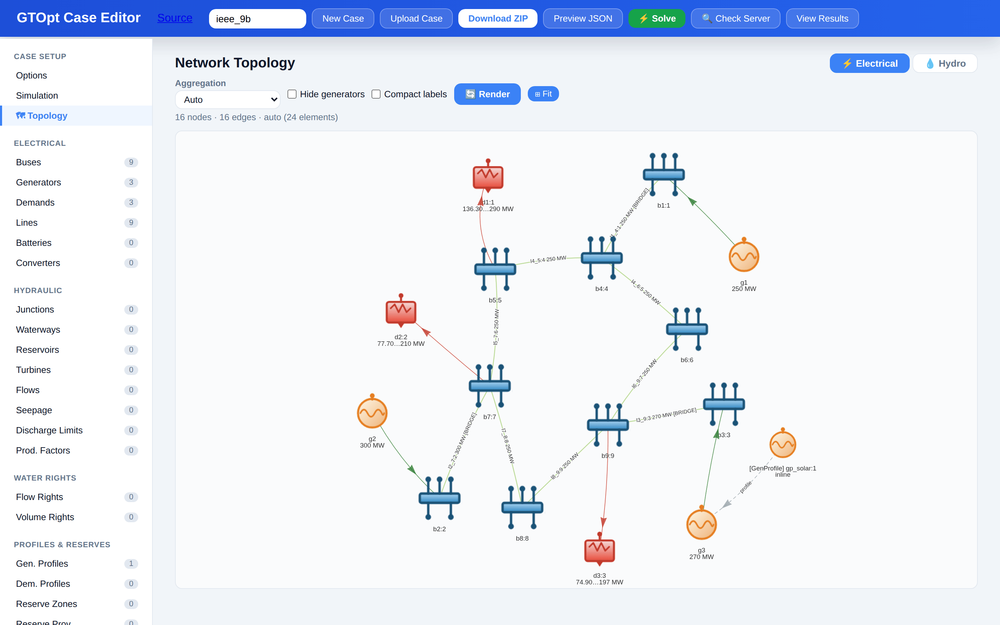
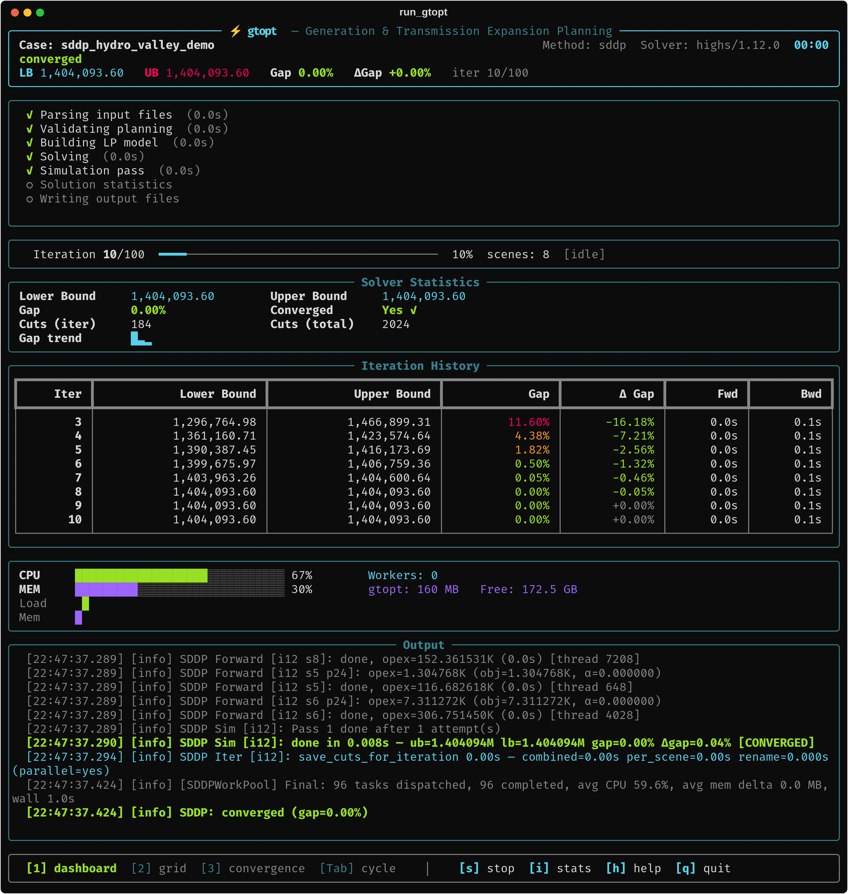
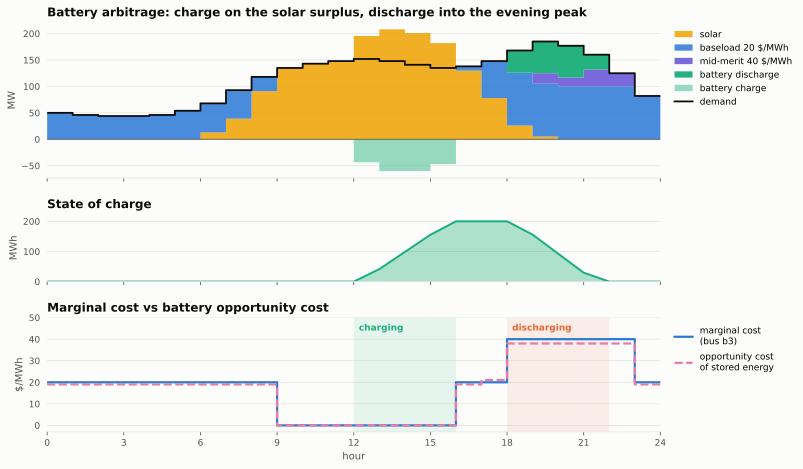

<h1>
  <picture>
    <source media="(prefers-color-scheme: dark)" srcset="docs/images/logo/gtopt-logo-dark.svg">
    
  </picture>
</h1>

[](https://github.com/gtopt-community/gtopt/actions/workflows/ubuntu.yml)
[](https://github.com/gtopt-community/gtopt/actions/workflows/style.yml)
[](https://github.com/gtopt-community/gtopt/actions/workflows/docs.yml)
[](LICENSING.md)

**GTOpt — Generation, Transmission and storage Optimization** — is an
open-source solver for planning and operating power systems. It builds sparse
LP/MIP models of multi-stage systems and minimizes the expected discounted
cost of investment and operation (CAPEX + OPEX):

- **Expansion planning** of generation, transmission, storage and demand (GTEP).
- **Hydrothermal scheduling** with SDDP and cascade decomposition.
- **Unit commitment and economic dispatch**, single-bus or DC OPF with
  losses.

**One consistent model, from minutes to decades.** The same element
definitions and the same formulation of the energy system — electricity,
water (reservoirs, cascades, irrigation rights), fuels and LNG,
hydrogen, ammonia and heat — are used at every time scale:

| Scale | Horizon | Resolution | Typical use |
|---|---|---|---|
| Operation | hours to days | 15-minute to hourly blocks | unit commitment, daily and weekly dispatch |
| Medium term | months to years | hourly or load-curve blocks | hydrothermal scheduling with SDDP |
| Planning | up to decades (30+ years) | representative blocks per stage | expansion of generation, transmission, storage and demand |

Only the time structure (`Stage` → `Block`, any block duration) and the
method change. The scales are coupled through **SDDP cuts**:

- **Optimality cuts** carry the water values and storage opportunity
  costs: the future-cost function of a longer study becomes the
  end-of-horizon valuation of a shorter one (`boundary_cuts`,
  `FutureCost`, SDDP hot start), and the cascade method refines a coarse
  model into a detailed one, inheriting its cuts.
- **Feasibility cuts**, from the elastic filter, enforce the hard limits
  — reservoir levels, irrigation and water rights — at each scale, so
  the policy handed from one scale to the next is also feasible.

The operation, medium-term and planning results are therefore
consistent and converge across scales, instead of coming from separate
models with different assumptions.

GTOpt is pronounced *G-top* (/ˈdʒiː tɒp/). The command-line binary is
`gtopt`.

<p align="center">
  <a href="docs/overview.md">
    
  </a>
</p>

## Features

- **Expansion planning**: co-optimized investment in **generation,
  transmission lines, storage** (battery energy and power separately) and
  **demand**, in modules with annualized costs, multi-stage and with
  capacity limits and derating. Expandable demand models loads that grow
  where and when the observed prices make them worthwhile (e.g.
  electrolysers, data centres, desalination, electrified industry): a
  demand module is added when the value of serving it exceeds its cost.
  Large problems use the OptGen-style investment master over SDDP
  operation ([Investment Master](docs/methods/expansion.md)).
- **Network**: single bus or DC power flow, with angle-based or
  loop-flow (cycle-basis) Kirchhoff formulations, line losses with
  several piecewise formulations, transmission expansion and optional
  optimal transmission switching.
- **Reduce, solve, project back**: networks can be reduced automatically
  for long-term studies (`gtopt-net`), with dispatch and investment
  decisions mapped back onto the full network.
- **Storage and hydro**: optimal management of reservoirs, hydro
  cascades, pumped hydro and batteries, with **water values** and the
  **opportunity cost of stored energy** per block, future-cost functions
  for the end of the horizon, and irrigation rights
  ([Storage and water values](docs/storage-and-water-values.md)).
- **Numerically curated**: per-element variable scaling, objective
  scaling and matrix equilibration (row-max, Ruiz), with the condition
  number reported for every solve, so one model can hold kWh-scale
  batteries next to TWh-scale reservoirs (Lake Laja stores about
  5,600 hm³, roughly 10 TWh through the El Toro–Antuco cascade) and still
  give stable dispatch, water values and opportunity costs in
  multi-node, multi-reservoir systems. Hard volume bounds and water-right
  limits are kept feasible in SDDP with an elastic filter and
  **feasibility cuts** ([SDDP §2.4](docs/methods/sddp.md#24-elastic-filter-for-feasibility)).
- **Unit commitment**: tight three-bin MIP formulation, start-up tiers,
  ramps, minimum up/down times, piecewise heat rates.
- **Reserves and inertia**: zonal up/down reserve requirements and
  minimum-inertia constraints co-optimized with energy, with shortage
  prices.
- **Plant-level detail**: combined-cycle configurations, pumps, reservoir
  seepage, head-dependent production factors and discharge limits, and
  free decision variables for custom rules.
- **Beyond electricity**: hydrogen and ammonia chains (electrolysers,
  fuel cells, storage), thermal storage and LNG terminals, in the same LP
  as the power system.
- **Emissions**: CO₂ and other greenhouse gases (CO₂-eq) and local
  pollutants (NOₓ, SO₂, particulate matter) per unit or fuel, with prices
  and caps by system-wide or regional zone (the cap's dual is the
  endogenous price), cap-and-trade allowance banking, carbon capture
  (CCS) per unit, and **marginal emission factors per bus and hour**,
  including the CO₂ impact of storage operation
  ([Emissions](docs/emissions.md)).
- **Constraints on demand, without code**: PAMPL, an AMPL-like language,
  adds user constraints, parameters, sums over elements, scenario/stage/
  block domains and cross-phase state terms to the LP from a text file.
  Complex operating rules are modelled this way — e.g. the **Chilean
  irrigation agreements** (Maule, Laja), built from water-right elements
  plus PAMPL constraints ([User Constraints](docs/user-constraints.md),
  [Irrigation Agreements](docs/irrigation-agreements.md)).
- **Methods**: monolithic LP/MIP, SDDP and multi-level cascade SDDP, with
  an OptGen-style investment master.
- **Uncertainty**: SDDP handles the stochasticity of **hydro inflows,
  solar and wind** (and demand) through scenarios and backward-pass
  apertures that vary inflows and renewable capacity factors, with
  multi-cut and (experimental) Markov-chain variants and AR(1) inflow
  models; the resulting cuts give the expected-cost water values and
  storage policies under that uncertainty
  ([SDDP](docs/methods/sddp.md)).
- **Solvers as plugins**: HiGHS, CPLEX, Gurobi, MindOpt, SCIP, CBC/CLP and
  cuOpt, loaded at run time.
- **National scale**: built for real power systems — the full Chilean
  national system (SEN), with its transmission network, hydro cascades,
  storage and multi-year horizons, is solved routinely; SDDP and cascade
  decomposition, parallel per-scenario LPs and network reduction
  (`gtopt_reduce_network`) keep large cases tractable.
- **From laptop to server and GPU**: the same binary runs on a laptop or
  a many-core server; scenes, phases and apertures are solved in
  parallel by an adaptive work pool, and NVIDIA cuOpt adds GPU solving.
- **Careful memory use**: LPs are kept compressed (lz4) between solves in
  low-memory mode, cuts can be capped and shared, and the work pool
  throttles dispatch on free memory, so large cases fit on modest
  machines.
- **Policies you keep**: SDDP cuts are saved as plain CSV after every
  iteration, so runs can be stopped, resumed (hot start), extended or
  reused as end-of-horizon future-cost functions, including cuts imported
  from PLP; `gtopt_monitor` follows a run live.
- **Warm starts that survive a solver change**: simplex bases and MIP
  starts are stored in solver-neutral form and reused across runs and
  backends.
- **Open, inspectable models**: every LP/MIP can be written to a standard
  LP file with readable names (`--lp-file`, `--lp-only`) and solved or
  checked with any solver; infeasible runs dump the LP, and
  `gtopt_check_lp` finds the conflicting constraints (IIS).
- **Auditable formulation**: the complete LP/MIP formulation, the SDDP
  cut-validity conditions and the inflow models are published with the
  source ([Formulation](docs/formulation/mathematical-formulation.md)),
  and an LP fingerprint records the structure of the model actually
  solved, so auditors and CI can check that a run uses the intended
  formulation ([LP fingerprint](docs/lp-fingerprint.md)).
- **Schema-first input**: `gtopt --json-schema` prints the JSON Schema of
  the input model, generated from the C++ code, for editor completion
  and validation before a run.
- **Open data end to end**: JSON cases and Apache Parquet/CSV inputs and
  results, readable by pandas, DuckDB, Spark or Power BI (`gtopt2pbi`),
  with no proprietary database or viewer. Converters from PLP, PLEXOS,
  PSR SDDP, PSS/E, pandapower, NREL Sienna, RTS-GMLC, NREL-118 and Excel,
  and export back to pandapower.
- **Interfaces**: command line, Python tools, a browser GUI and a REST web
  service.
- **Engineering**: unit, integration and Python test suites, static
  analysis (CodeQL, clang-tidy) and coverage run on every change.

<p>
  <a href="docs/interfaces.md"></a>
  <a href="docs/scripts-guide.md#run_gtopt"></a>
</p>

## Install

On Ubuntu 24.04+ or Debian 13+:

```bash
curl -fsSL https://raw.githubusercontent.com/gtopt-community/gtopt/master/install.sh | bash
```

The script installs the system packages and the open-source solvers HiGHS
and CBC/CLP, builds GTOpt from source and installs it in `/usr/local` (it
asks for `sudo`). Useful options:

```bash
# Install in your home directory, plus the Python tools (plp2gtopt, plexos2gtopt, ...)
curl -fsSL https://raw.githubusercontent.com/gtopt-community/gtopt/master/install.sh \
  | bash -s -- --prefix "$HOME/.local" --python
```

Run `install.sh --help` for all options. For other platforms, manual builds
and build options, see the **[Building Guide](BUILDING.md)**.

## Solvers

GTOpt needs at least one LP/MIP solver. Solvers are plugins
(`libgtopt_solver_*.so`) built for every solver found when GTOpt is
compiled, and chosen at run time with `--solver`; `gtopt --solvers` lists
the ones available.

| Solver | Licence | How to get it | Notes |
|---|---|---|---|
| [HiGHS](https://highs.dev) | MIT, free | Installed by `install.sh` (apt `libhighs-dev` on Ubuntu 25.04+, otherwise built from source) | Recommended open-source choice |
| [CBC / CLP](https://github.com/coin-or/Cbc) | EPL, free | Installed by `install.sh` (apt `coinor-libcbc-dev`) | Always available |
| [SCIP](https://scipopt.org) | Apache-2.0, free | [scipopt.org](https://scipopt.org); set `SCIP_ROOT_DIR` | Opt-in: `--solver scip` |
| [CPLEX](https://www.ibm.com/products/ilog-cplex-optimization-studio) | Commercial (free academic) | IBM ILOG CPLEX Optimization Studio; set `CPLEX_ROOT_DIR` | Preferred when present |
| [Gurobi](https://www.gurobi.com) | Commercial (free academic) | gurobi.com; set `GUROBI_HOME` | Opt-in: `--solver gurobi` |
| [MindOpt](https://opt.alibabacloud.com) | Commercial | Alibaba Cloud; set `MINDOPT_HOME` | |
| [cuOpt](https://github.com/NVIDIA/cuopt) | Apache-2.0, free | `pip install libcuopt-cu12`, or set `CUOPT_HOME`; needs an NVIDIA GPU | Opt-in: `--solver cuopt` |

Without `--solver`, GTOpt picks the first available of CPLEX, HiGHS,
MindOpt, CBC and CLP.

To build GTOpt with a commercial solver, install the solver first and pass
its location to the installer (to `bash`, not to `curl`):

```bash
curl -fsSL https://raw.githubusercontent.com/gtopt-community/gtopt/master/install.sh \
  | CPLEX_ROOT_DIR=/opt/ibm/ILOG/CPLEX_Studio2211/cplex bash
curl -fsSL https://raw.githubusercontent.com/gtopt-community/gtopt/master/install.sh \
  | GUROBI_HOME=/opt/gurobi1203/linux64 bash
```

Running the installer again rebuilds GTOpt with the solvers it now finds.
Solver details and manual builds: [Building Guide](BUILDING.md).

## Quick start

```bash
git clone https://github.com/gtopt-community/gtopt.git
cd gtopt/cases/c0
gtopt system_c0.json --set output_directory=/tmp/c0-out
```

`cases/c0` is a single-bus system with one generator and one demand and
capacity expansion over 5 stages. Results are written to `/tmp/c0-out`
(without `--set`, to the case's `output/`, which holds the reference
results used by the tests), one file per component; status `0` in
`solution.csv` means the optimum was found.

Common options:

```bash
gtopt case.json --set output_directory=results/   # where to write results
gtopt case.json --set use_single_bus=true         # ignore the network
gtopt case.json --solver highs                    # pick a solver backend
```

A battery example: `cases/bat_4b_24` is a 4-bus network with solar, a
60 MW / 200 MWh battery and 24 hourly blocks. In the variant built by
`tools/figures/make_battery_demo_case.py` (more solar, a smaller baseload
unit and a 90 $/MWh peaker) the price swings over the day. The battery
charges on the midday solar surplus, when the marginal cost is zero, and
discharges into the evening peak, so the peaker is never needed. Its
**opportunity cost of stored energy** (the dual of its energy balance)
explains the dispatch: it charges while the marginal cost is below that
value and discharges when it is above.

<p align="center">
  <a href="docs/storage-and-water-values.md"></a>
</p>

Next steps: the **[first-solve walkthrough](docs/planning-guide.md#quickstart-your-first-solve)**
and the **[Usage Guide](docs/usage.md)**.

## How GTOpt compares

GTOpt works alongside the models used in the region and reads their
inputs. A qualitative overview:

| | **GTOpt** | **PLP** | **PLEXOS** | **PSR SDDP** |
|---|---|---|---|---|
| Maintained by | GTOpt Community | [CEN](https://www.coordinador.cl/operacion/documentos/modelacion-del-sen/modelos-para-la-planificacion-y-programacion-de-la-operacion/) | Energy Exemplar | PSR |
| Licence | AGPL-3.0 or commercial | see CEN | commercial | commercial |
| Formulation documentation | full LP/MIP formulation published with the code | CEN documentation | vendor documentation | vendor documentation and papers |
| LP solver | your choice: HiGHS, CBC/CLP, SCIP, cuOpt, CPLEX, Gurobi, MindOpt | CLP (via OSI) | see vendor | see vendor |
| Data formats | JSON + Parquet/CSV | text `.dat` files | vendor database/XML | vendor formats |
| Read by GTOpt | — | `plp2gtopt` | `plexos2gtopt` (published inputs) | `sddp2gtopt` |

Details, element by element, in
[Comparison with other tools](docs/tools/comparison.md).

## Roadmap: bid-based markets

GTOpt is being extended toward **offer-based electricity markets**, in
line with the transition of the Chilean power system from audited-cost
dispatch to a market with bids:

- a single, consistent dispatch chain — from medium-term water values to
  day-ahead and intraday scheduling — clearing **offers instead of
  audited costs**;
- co-optimization of **energy and ancillary services**, with nodal
  prices;
- market layers for **capacity/sufficiency**, long-term energy
  (reservoirs, LNG take-or-pay) and **financial transmission rights**;
- a market simulator to test designs and bidding behaviour on the full
  system before they are applied.

This work is in development; feedback and collaboration are welcome in
[Discussions](https://github.com/gtopt-community/gtopt/discussions).

## Validation

GTOpt is validated at three levels. **The Chilean national electric
system (SEN)**: full-scale long-term hydrothermal planning cases built
from PLP data with `plp2gtopt` and solved with SDDP and cascade SDDP,
with the generated LPs compared element by element against PLP's
([PLP vs GTOpt](docs/lp-comparison.md)), and daily/weekly operation
cases built with `plexos2gtopt` from the PLEXOS input bundles that the
system operator (CEN) publishes for its daily programming, with the
GTOpt dispatch, prices and losses compared against the PLEXOS solutions
the CEN publishes alongside them (we do not run PLEXOS; only the
published inputs and outputs are used; the comparison is in
`scripts/plexos2gtopt/compare_with_plexos.py`).
**External reference systems and models**: IEEE 4/9/14/30/57/118-bus
and RTS-24 networks, MATPOWER `case3375wp`, DC OPF results from
pandapower, the SDDP.jl hydro-valley and hydro-thermal examples and
published SDDP benchmarks
([literature benchmarks](docs/examples/sddp-literature-benchmarks.md)),
PSR SDDP sample cases via `sddp2gtopt`, UnitCommitment.jl and NREL
Sienna unit-commitment cases, the NREL-118 and RTS-GMLC systems, and
ports of GenX and PyPSA emission models. **Continuous integration**:
more than 4,600 C++ unit and integration tests and several thousand
Python tests, with reference results for the cases in
[`cases/`](cases/) checked on every change. See also [Comparison with other
tools](docs/tools/comparison.md).

## Tools and interfaces

| | What it is | Docs |
|---|---|---|
| **Python tools** | Converters (`plp2gtopt`, `plexos2gtopt`, `psse2gtopt`, `sddp2gtopt`, `pp2gtopt`, `igtopt`), diagrams, marginal units and emissions (`gtopt-marginal-units`), `run_gtopt` and checkers | [Scripts Guide](docs/scripts-guide.md) |
| **GUI** | Browser interface to build, solve and inspect cases (`gtopt_gui`) | [GUI and web service](docs/interfaces.md) |
| **Web service** | REST API to submit cases and fetch results (`gtopt_websrv`) | [GUI and web service](docs/interfaces.md) |
| **C++ library** | The solver as a library, plus the Apache-2.0 Extension SDK for solver plugins | [API reference](https://gtopt-community.github.io/gtopt/) |

## Documentation

All documentation is indexed in **[docs/README.md](docs/README.md)**. The
main entry points:

- [Understanding GTOpt](docs/overview.md): architecture, data flow and
  repository layout.
- [Planning Guide](docs/planning-guide.md): time structure, system elements,
  JSON format and worked examples.
- [Mathematical Formulation](docs/formulation/mathematical-formulation.md):
  the full LP/MIP model.
- [SDDP](docs/methods/sddp.md) and [Cascade](docs/methods/cascade.md)
  methods.
- [Comparison with other tools](docs/tools/comparison.md): PLP, pandapower,
  PyPSA and GenX.
- [White paper](docs/white_paper/main.pdf) ([LaTeX source](docs/white_paper/)):
  the reference paper, covering the formulation, solution methods,
  multi-scale coupling, architecture, validation and the comparison with
  the Chilean daily schedule.

## Citing GTOpt

If you use GTOpt in your work, please cite it as described in
[`CITATION.cff`](CITATION.cff) (the "Cite this repository" button on
GitHub). The reference paper is the GTOpt
[white paper](docs/white_paper/main.pdf) (preprint, arXiv submission in
preparation). Papers about GTOpt and its predecessor FESOP are listed in
[`PUBLICATIONS.md`](PUBLICATIONS.md).

## Contributing

Contributions are welcome: see [`CONTRIBUTING.md`](CONTRIBUTING.md). Pull
requests need a one-time [Contributor License Agreement](CLA.md), which the
CLA bot requests on your first PR. Questions and ideas go to
[Discussions](https://github.com/gtopt-community/gtopt/discussions);
security issues to [`SECURITY.md`](SECURITY.md).

## Acknowledgements

GTOpt is built on the work of many open-source projects, and we are very
grateful to their authors and communities, in particular:

- **Solvers**: [HiGHS](https://github.com/ERGO-Code/HiGHS),
  [COIN-OR CLP/CBC](https://github.com/coin-or),
  [SCIP](https://github.com/scipopt/scip) and
  [NVIDIA cuOpt](https://github.com/NVIDIA/cuopt).
- **C++ libraries**: [Apache Arrow / Parquet](https://github.com/apache/arrow),
  [Boost](https://github.com/boostorg/boost),
  [DAW JSON Link](https://github.com/beached/daw_json_link),
  [spdlog](https://github.com/gabime/spdlog),
  [strong_type](https://github.com/rollbear/strong_type),
  [doctest](https://github.com/doctest/doctest) and
  [CPM.cmake](https://github.com/cpm-cmake/CPM.cmake).
- **Python**: [NumPy](https://github.com/numpy/numpy),
  [pandas](https://github.com/pandas-dev/pandas),
  [PyArrow](https://github.com/apache/arrow),
  [pandapower](https://github.com/e2nIEE/pandapower),
  [NetworkX](https://github.com/networkx/networkx),
  [Flask](https://github.com/pallets/flask) and
  [Rich](https://github.com/Textualize/rich).
- **Web**: [Next.js](https://github.com/vercel/next.js),
  [React](https://github.com/facebook/react),
  [Chart.js](https://github.com/chartjs/Chart.js) and
  [Jspreadsheet CE](https://github.com/jspreadsheet/ce).
- **Models and test data**: [SDDP.jl](https://github.com/odow/SDDP.jl),
  [UnitCommitment.jl](https://github.com/ANL-CEEESA/UnitCommitment.jl),
  [MATPOWER](https://github.com/MATPOWER/matpower),
  [NREL Sienna](https://github.com/NREL-Sienna) and
  [PSRClassesInterface.jl](https://github.com/psrenergy/PSRClassesInterface.jl).

All of them are used under their own licences, which are compatible with
GTOpt's; the full list, with versions and the compatibility analysis, is in
[`THIRD_PARTY_NOTICES.md`](THIRD_PARTY_NOTICES.md).

## License

The GTOpt core is **dual-licensed**: AGPL-3.0-or-later with the
[solver plugin exception](LICENSE-EXCEPTION.md), or a
[commercial license](LICENSE-COMMERCIAL.md). The Extension SDK (the
solver-plugin interface headers) is Apache-2.0, so plugins and apps may use
any licence. See [`LICENSING.md`](LICENSING.md) and
[`TRADEMARKS.md`](TRADEMARKS.md). Third-party components keep their own
licences; see [`THIRD_PARTY_NOTICES.md`](THIRD_PARTY_NOTICES.md).

Copyright (c) 2024-2026 Marcelo Matus and [contributors](AUTHORS).

## Support and maintenance

Professional support, maintenance, training and PLP / PLEXOS → GTOpt
migration services are available from **Black Bear Engineering SpA**
(<contacto@blackbeareng.cl>). See [`PARTNERS.md`](PARTNERS.md).
