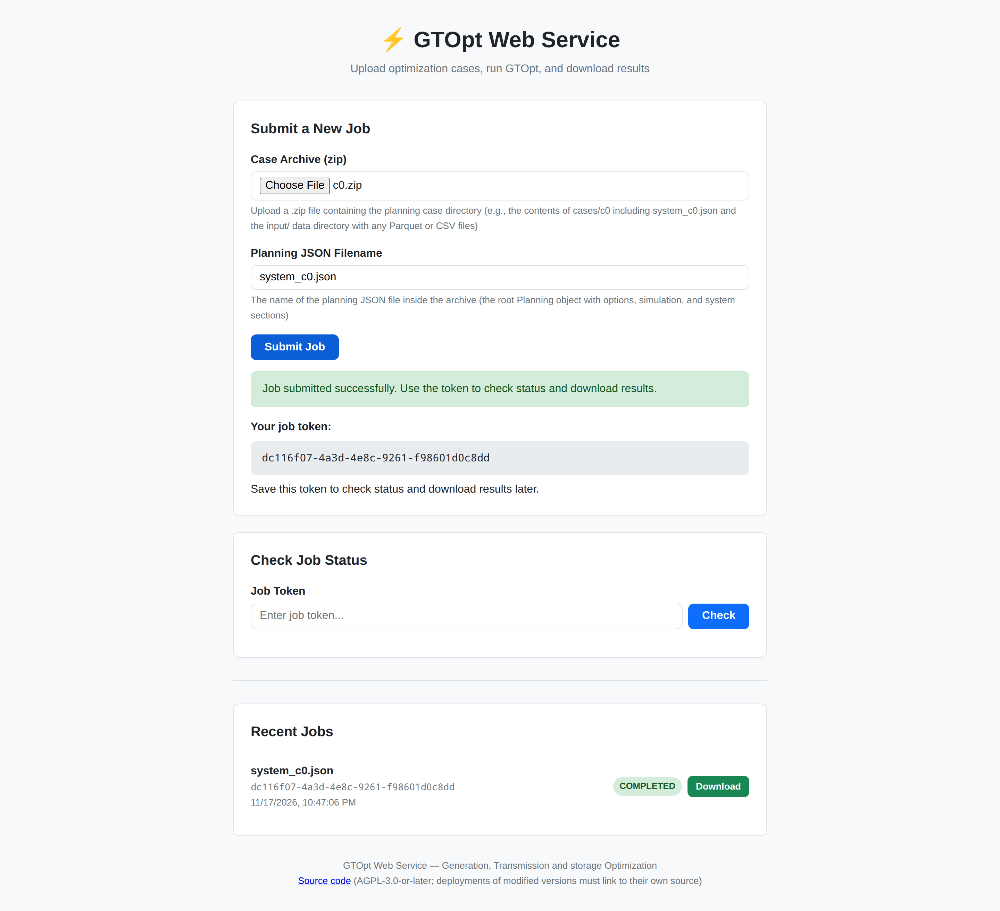

# GUI and Web Service

GTOpt has two optional interfaces on top of the `gtopt` binary:

- the **GUI service** (`gtopt_gui`, `gtopt_guisrv`): a browser interface to
  create, edit, solve and visualize cases;
- the **web service** (`gtopt_websrv`): a REST API and web page to upload
  cases, run the solver and download results.

Both bind to `127.0.0.1` by default.  They are installed separately from the
solver.

## GUI service

A web-based graphical interface for creating, editing, and visualizing GTOpt
cases. The GUI service also connects to the GTOpt webservice for remote
solving.


*Screenshots: `cases/ieee_9b` solved with HiGHS, captured with
[`tools/figures/capture_gui.py`](../tools/figures/capture_gui.py).*

### Quick Start with gtopt_gui

The easiest way to launch the GUI is with the `gtopt_gui` command, which provides
a complete integrated environment for editing, solving, and viewing optimization cases:

```bash
# Install guiservice (independent of gtopt binary)
cmake -S guiservice -B build-gui
sudo cmake --install build-gui

# Install Python dependencies
pip3 install -r /usr/local/share/gtopt/guiservice/requirements.txt

# Launch interactively (opens browser, auto-starts webservice)
gtopt_gui

# Or with a specific configuration file
gtopt_gui system_c0.json
```

**Fully Integrated Workflow:**
- Opens a web browser with a standalone GUI interface
- Automatically starts local webservice (if installed) for solving cases
- Automatically detects GTOpt binary
- Complete workflow: Edit → Submit for Solving → Monitor → View Results
- Zero configuration required

**In the browser:**
1. Upload or create a case
2. Edit system elements (buses, generators, storage, demands)
3. Click "Submit for Solving" - runs on auto-started local webservice
4. Monitor job progress in real-time
5. View results with interactive charts and tables

For detailed usage and options, see [guiservice/GTOPT_GUI.md](../guiservice/GTOPT_GUI.md).

### GUI Plus (Next.js / React front-end)

An alternative modern front-end — **GUI Plus** — is available under
[`guiservice-plus/`](../guiservice-plus/). It is a Next.js 15 + React 19 +
Tailwind v4 + shadcn/ui single-page app that sits on top of the existing
Flask `guiservice` and offers an interactive topology editor (ReactFlow),
technology-coloured dispatch stack charts, SDDP convergence views, a merit
order table, and a KPI dashboard.

```bash
# Launch both the Flask guiservice and GUI Plus together
gtopt_gui --ui-plus --ui-plus-port 5002

# Or run it standalone against an existing Flask guiservice
cd guiservice-plus && npm install
GTOPT_GUISERVICE_URL=http://localhost:5001 npm run dev -- -p 5002
```

See [guiservice-plus/README.md](../guiservice-plus/README.md) for details.

### Quick Start with gtopt_guisrv

For running the GUI service as a web server (without opening a browser):

```bash
# Start GUI service on default port 5001
gtopt_guisrv

# Or with custom options
gtopt_guisrv --port 8080
```

The service binds to `127.0.0.1` by default. `--debug` is for local
development only and is refused on non-loopback addresses.

For detailed usage and systemd service setup, see [guiservice/GTOPT_GUISRV.md](../guiservice/GTOPT_GUISRV.md).

### Manual Start

You can also run the GUI service directly:

```bash
pip install -r guiservice/requirements.txt
cd guiservice
python app.py
# Open http://localhost:5001 in your browser
```

For detailed installation and deployment instructions, see
[guiservice/INSTALL.md](../guiservice/INSTALL.md).

## Web service

GTOpt includes a web service that lets you upload optimization cases, run the
solver, and download results — all through a browser or REST API.

<p align="center">
  
</p>

### Quick Start with gtopt_websrv

Install and run the web service using the `gtopt_websrv` command:

```bash
# Install webservice (independent of gtopt binary)
cmake -S webservice -B build-web
sudo cmake --install build-web

# Install Node.js dependencies (including build dependencies)
cd /usr/local/share/gtopt/webservice
npm install
npm run build

# Launch the web service
gtopt_websrv

# Or with options
gtopt_websrv --port 8080
gtopt_websrv --gtopt-bin /path/to/gtopt
```

### REST API example

The same workflow from the command line, with `curl` (the job token is
returned by the first call):

```bash
# Zip a case and submit it
(cd cases/c0 && zip -r /tmp/c0.zip system_c0.json system_c0)
curl -F file=@/tmp/c0.zip -F systemFile=system_c0.json \
  http://localhost:3000/api/jobs
# {"token":"<TOKEN>","status":"pending","message":"Job submitted successfully. ..."}

# Poll the job status (pending → running → completed / failed)
curl http://localhost:3000/api/jobs/<TOKEN>

# Download the results as a zip
curl -o c0-results.zip http://localhost:3000/api/jobs/<TOKEN>/download
```

Other endpoints: `GET /api/jobs` (list jobs), `GET /api/jobs/<TOKEN>/logs`,
`GET /api/jobs/<TOKEN>/monitor`, `POST /api/jobs/<TOKEN>/stop` and
`GET /api/ping`.

For detailed installation and deployment instructions, see [webservice/INSTALL.md](../webservice/INSTALL.md).
