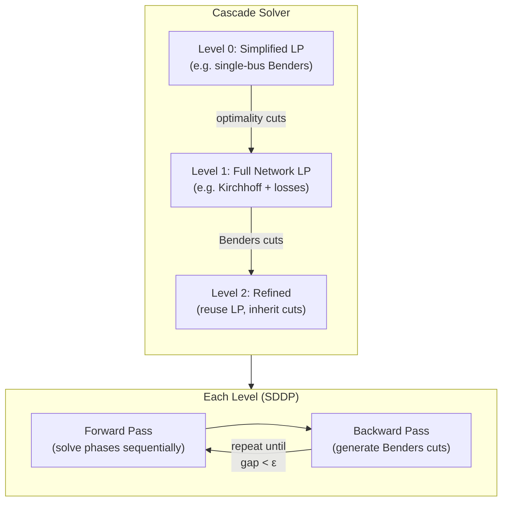
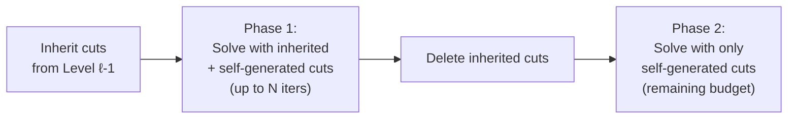
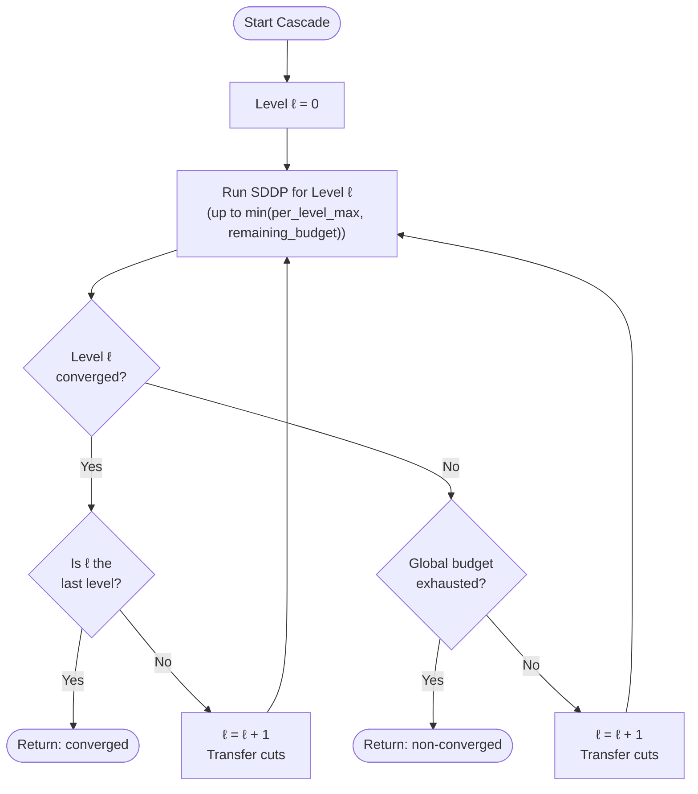

# Cascade Solver -- Multi-Level Hybrid SDDP in GTOpt

## 1. Introduction

The **Cascade solver** (`method = "cascade"`) orchestrates multiple
SDDP/Benders decomposition levels, each with its own LP formulation and
solver configuration.  The key idea is to start with a simplified model
(e.g. uninodal/transport network) that converges quickly, then
progressively refine towards the full network model, warm-starting each
subsequent level with information from the previous one.

Each level internally runs an `SDDPMethod` instance (the same solver
documented in [SDDP Method](sddp.md)).  The cascade solver
adds an outer loop that manages LP construction, solver lifecycle, and
information transfer between levels.

### When to use the Cascade Solver

| Criterion | Plain SDDP | Cascade |
|-----------|-----------|---------|
| Network complexity | Single formulation | Graduated: uninodal -> transport -> full |
| Convergence speed | One level, all iterations | Faster via warm-start from simpler models |
| LP rebuild cost | One LP | Multiple LPs (amortized by fewer iterations) |
| Configuration effort | Minimal | Per-level settings required |

The cascade solver is most beneficial when:

- The full network model (Kirchhoff + line losses) takes many Benders
  iterations to converge.
- A simplified model (single bus) converges quickly and provides a good
  starting point for the full model.
- The problem has many phases, increasing the number of state variable
  links and thus the iterations needed for cut convergence.

### Architecture Overview



---

## 2. Key Concepts

### 2.1 Levels

A cascade consists of an ordered sequence of **levels**, each defined in
the `cascade_options.level_array` array.  Each level specifies:

- **LP formulation** (`model_options`): network topology, Kirchhoff
  constraints, line losses, scaling.
- **Solver parameters** (`sddp_options`): iteration limits, apertures,
  convergence tolerance.
- **Transition rules** (`transition`): how to receive information from
  the previous level (optimality cuts).

### 2.2 LP Rebuild vs Reuse

When a level's `model_options` is **present**, a new `PlanningLP` is
built from scratch with the specified formulation.  When `model_options`
is **absent**, the previous level's LP and solver state are reused.
This distinction is important:

- **Rebuild** (model_options present): useful when the network topology
  changes (e.g. single bus -> multi-bus with Kirchhoff).  Column
  indices change, so cuts must be transferred via named resolution.
  The rebuilt LP takes `options.lp_matrix_options`, and an unset
  `equilibration_method` follows the level's own topology (`ruiz` for
  multi-bus Kirchhoff, `row_max` otherwise).
- **Reuse** (model_options absent): useful when only solver parameters
  change (e.g. enabling apertures for SDDP after a Benders warm-start).
  The solver state (cuts, basis) is preserved, avoiding rebuild cost.

### 2.3 Training Iterations and Simulation Pass

Each level runs up to N training iterations (forward + backward passes)
followed by 1 final simulation pass (forward-only).  The training
iterations generate Benders cuts and improve the lower bound; the
simulation pass evaluates the policy without adding cuts.

The `SDDPMethod` returns N+1 results: N training iterations + 1
simulation pass.  Only the N training iterations count towards the
global iteration budget.

### 2.4 Keyed Transfer

Cuts are serialized with a typed **state-variable key** per coefficient
— `(class, variable, uid)`, e.g. `(Reservoir, efin, 7)` or
`(Sddp, alpha, 1)` — never with a column index.  When a level rebuilds
the LP with a different formulation or a different (reduced) network,
column indices change (a 2-node LP has a handful of columns per block,
the full network thousands), and the loader resolves each key against
the new level's state-variable map.  No LP column names are needed.

A coefficient whose key does not exist in the new LP is dropped with a
warning (`coeff (...) not found in state variables`).  Reduced networks
must therefore keep every state element (reservoirs, batteries, other
storages) with its original `uid` — `gtopt-net reduce` does: it only
rewrites buses and lines and re-points components to their cluster bus.

### 2.5 Reduced Networks per Level

`CascadeLevel.system_file` points a level at a JSON file whose `system`
replaces the planning's system **for that level only** (its `options` and
`simulation` blocks are ignored; the level's `model_options` stay
authoritative).  The path is tried as given, then under
`options.input_directory`.  A level with `system_file` always builds a
fresh LP; a later level without `system_file` builds from the
**original** system again.

The reduced systems are produced by `gtopt-net reduce`
(`scripts/gtopt_reduce_network`):

| Level shape | Command |
|-------------|---------|
| Zonal / country nodes | `gtopt-net reduce case.json --bus-group-regex '^(CL\|PE)_' -o L0.json` (or `--bus-groups groups.csv`) |
| X % of the buses | `gtopt-net reduce case.json --bus-ratio 0.3 --protect-constraint-lines -o L1.json` |

Each run also writes `<out>.busmap.csv`, `.linemap.csv`, `.aggregator.csv`
and `.reducer_config.json`; `gtopt-net project-results` maps a reduced
level's output back to the original buses.

`--protect-line UID` keeps a line (e.g. an interconnector) intact in every
reduced level.  Parquet-stem line fields (`"tmax_ab": "<stem>"`) are
resolved relaxation-wise: a line is present if active in any stage, its
capacity is the maximum over the horizon, and a cluster bus is in service
whenever any member bus is; X/R are re-expressed in Ω at the most common
line voltage before merging, and equivalent lines carry that voltage.

Fixed bus groups (`--bus-group-regex` / `--bus-groups`) skip the
clustering: one bus per group (representative = smallest anchor uid in
the group, else smallest bus uid), lines inside a group vanish, lines
between groups are aggregated with their capacities summed (a single
link, e.g. an interconnector, keeps its capacity).

**Validity of inherited cuts.**  A reduced level whose network is a
*relaxation* of the next level's — buses merged, inter-cluster
capacities summed, no Kirchhoff, no losses — has a cost-to-go
`Q_red(x) <= Q_full(x)` for every state `x`, so its Benders cuts are
valid lower bounds for the full network and can be inherited forever
(`inherit_optimality_cuts: -1`); the full level then converges to the
full-network optimum (pinned by `test_cascade_reduced_levels.cpp`).  A
reduced level **with** Kirchhoff on equivalent reactances, or with
losses on equivalent resistances, is not a relaxation in general: its
cuts can overestimate the full cost-to-go.  Inherit them with
`inherit_optimality_cuts: N > 0` (forget after N iterations) when an
exact final bound is required; with `-1` watch for a negative gap
(LB > UB) at the full level, the signature of an over-tight
inherited cut.

### 2.6 Per-Level Outputs

By default only the last active level writes a solution; intermediate
levels skip their simulation pass.  With
`cascade_options.write_level_outputs: true` every intermediate active
level runs its simulation pass and writes a complete output set to
`<output_directory>/<level name>/`:

| File / directory | Content |
|------------------|---------|
| `<Element>/…` | Per-element solution (Parquet/CSV, as `output_format`) |
| `solution.csv` | Per-(scene, phase) objective and status |
| `cuts/` | The level's cuts (also the `--recover` checkpoint) |
| `solver_status.json` | Copy of the solver status at the end of the level |
| `level_summary.json` | Iterations, bounds, gap, cuts, elapsed time, `system_file` |

The last active level keeps writing to `<output_directory>`, and
`<output_directory>/cascade_levels.csv` gets one row per finished level
(rewritten after every level).  For a reduced level, the busmap/linemap
written next to its `system_file` project the level output back to the
original network (`gtopt-net project-results`).  Cost: one extra
forward (simulation) pass plus the write-out per intermediate level.

---

## 3. Transfer Mechanism

The cascade solver transfers **optimality cuts** between levels.  This
is controlled via the `transition` sub-object on each level (except
level 0, which has no predecessor).

### 3.1 Cut Inheritance

When `inherit_optimality_cuts` is non-zero, the solver serializes all
stored optimality cuts from the previous level into a temporary Parquet
file keyed by state variable (Section 2.4), then loads them into the new
LP.  (Feasibility cuts are not carried across levels —
each level's forward pass regenerates them as needed.)

The transfer process:

1. At the end of the previous level (while its LP is still alive) the
   stored optimality cuts are serialized via `save_cuts_parquet()`, with
   one `(class, variable, uid)` key per coefficient.
2. The previous level's LP and solver are released.
3. At the next level, after the solver is initialized (so alpha
   variables exist), `load_cuts()` reads the file and resolves each key
   against the new level's state-variable map.
4. Coefficients whose key does not resolve are dropped with a warning.

**Dual threshold filtering** (the former `optimality_dual_threshold`
transition field) was removed: the main cell's row duals are stale for
cuts added after its last solve, so every inherited cut is transferred.

**Example: 6-phase system with cut inheritance**

```text
Level 0 [training]:   up to 15 iters, converges with N cuts
Level 1 [with_cuts]:  inherits N cuts -> converges in fewer iters
```

The 6-phase test case (`"Cascade 2-level with cut inheritance only
(6-phase)"`) demonstrates that level 1 converges in strictly fewer
iterations than level 0, and both levels reach the same optimal value.

### 3.2 Multi-Level Cut Cascade

A 3-level cascade can chain cut inheritance through progressively
refined LP formulations:

```text
Level 0 [benders]:  uninodal, fast convergence, rough solution
Level 1 [guided]:   full network, fresh LP from scratch
Level 2 [refined]:  same LP as level 1, inherits cuts -> faster
```

A representative pattern:

- Level 0 runs uninodal Benders (`use_single_bus=true`) for fast
  convergence.
- Level 1 builds a full network LP (`use_kirchhoff=true`) from scratch;
  the uninodal cuts are not transferred because the LP structure
  changed.
- Level 2 reuses level 1's LP (no `model_options`) and inherits
  optimality cuts, converging faster than level 1.

All three levels reach the same optimal value, and level 2 converges
in fewer iterations than level 1.

---

## 4. Configuration Reference

### 4.1 JSON Schema Overview

Cascade options are set in their own `cascade_options` sub-object
within the top-level `options` object:

```json
{
  "options": {
    "method": "cascade",
    "sddp_options": { ... },
    "cascade_options": {
      "model_options": { ... },
      "sddp_options": { ... },
      "level_array": [ ... ]
    }
  }
}
```

The option resolution chain is:

1. **Base `sddp_options`** (top-level) -- provides defaults for all
   SDDP parameters (convergence_tol, elastic_penalty, etc.)
2. **`cascade_options.sddp_options`** -- overrides base for cascade
   levels; `max_iterations` here is the global iteration budget
3. **Per-level `sddp_options`** -- overrides cascade global for a
   specific level

### 4.2 CascadeOptions Fields

| Field | Type | Default | Description |
|-------|------|---------|-------------|
| `model_options` | ModelOptions | (none) | Global model defaults for all levels |
| `sddp_options` | SddpOptions | (none) | Global SDDP defaults; `max_iterations` = global budget |
| `level_array` | array | `[]` | Array of CascadeLevel objects |
| `write_level_outputs` | bool | `false` | Write a full output set per intermediate level to `<output_directory>/<level name>/` (Section 2.6) |

When `level_array` is empty, a single default level is created that
passes through all options, making the cascade solver equivalent to a
plain SDDP solver.

### 4.3 CascadeLevel Fields

| Field | Type | Default | Description |
|-------|------|---------|-------------|
| `uid` | int | (auto) | Unique level identifier |
| `name` | string | `"level_N"` | Human-readable name (for logging) |
| `active` | bool | `true` | `false` skips the level entirely |
| `model_options` | ModelOptions | (absent) | LP formulation overrides; absent = reuse previous LP |
| `system_file` | string | (absent) | JSON whose `system` replaces the network for this level (Section 2.5) |
| `aperture_system_file` | string | (absent) | Simplified system for this level's backward-pass apertures |
| `sddp_options` | CascadeLevelMethod | (absent) | Per-level solver parameters |
| `transition` | CascadeTransition | (absent) | Transfer rules from previous level |

### 4.4 CascadeLevelMethod Fields

| Field | Type | Default | Description |
|-------|------|---------|-------------|
| `max_iterations` | int | from global | Max training iterations for this level |
| `min_iterations` | int | from global | Min iterations before convergence |
| `apertures` | array of UIDs | from global | Aperture UIDs; `[]` = pure Benders, absent = inherit |
| `num_apertures` | int | from global | First-N per-phase aperture selector |
| `aperture_selection_mode` | string | from global | `head` (first N, i.e. the N wettest under the plp2gtopt order), `stride`, `tail` |
| `aperture_chunk_size` | int | from global | Apertures per task; `-1` = serial per scene on one clone |
| `convergence_tol` | real | from global | Relative gap tolerance |
| `forward_solver_options` | SolverOptions | from global | Forward-pass solver options for this level, layered on `sddp_options.forward_solver_options`: the optional fields the level sets win (tolerances, `mip_gap`, `time_limit`, `scaling`, `barrier_solver`, `mip_lp_algorithm`, `mip_heuristic_effort`, `param_file`, …); `algorithm`, `threads` and `crossover` are not per-level. CLI: `--set cascade_options.level_array.N.sddp_options.forward_solver_options.barrier_solver=ipx` |
| `backward_solver_options` | SolverOptions | from global | Backward-pass counterpart of `forward_solver_options` |

### 4.5 CascadeTransition Fields

| Field | Type | Default | Description |
|-------|------|---------|-------------|
| `inherit_optimality_cuts` | int | `0` | `0` = do not inherit; `-1` = inherit and keep forever; `N > 0` = inherit, then forget after N training iterations |

#### Cut Forgetting Semantics

When `inherit_optimality_cuts` is a positive integer N, the solver runs
in two phases:

1. **Phase 1** (up to N iterations): solve with inherited cuts plus
   self-generated cuts.  The per-level iteration cap is temporarily set
   to `min(N, remaining_budget)`.
2. **Phase 2** (remaining budget): delete all inherited cuts from the LP,
   then re-solve using only self-generated cuts.

This prevents over-reliance on potentially inaccurate cuts from a
simplified LP while still benefiting from the warm-start.



### 4.6 ModelOptions Fields

| Field | Type | Default | Description |
|-------|------|---------|-------------|
| `use_single_bus` | bool | `false` | Collapse network to a single bus (copper-plate) |
| `use_kirchhoff` | bool | `true` | Enable DC Kirchhoff voltage-law constraints |
| `use_line_losses` | bool | `false` | Model resistive line losses |
| `kirchhoff_threshold` | real | 0.0 | Min bus voltage [kV] for Kirchhoff |
| `loss_segments` | int | 1 | Piecewise-linear segments for quadratic losses |
| `scale_objective` | real | 1000 | Divisor for objective coefficients |
| `scale_theta` | real | auto | Voltage-angle enlargement: θ_LP = scale_theta · θ (rad); auto = 1/(3·median(X/V²)); 1 = radians; 1000 = milliradians |
| `demand_fail_cost` | real | 1000 | Penalty for unserved demand [$/MWh] |
| `reserve_fail_cost` | real | 1000 | Penalty for unserved reserve [$/MWh] |

> **Note**: `annual_discount_rate` has moved to the `simulation`
> section.  For backward compatibility, it is still accepted in
> `model_options`.

See also [Input Data Reference](../input-data.md) for the full JSON input
specification.

---

## 5. Examples

### 5.1 Cut Inheritance (2-Level)

Two levels on the same full-network LP.  Level 0 trains cuts from
scratch; level 1 inherits those cuts and converges faster.

```json
{
  "options": {
    "method": "cascade",
    "sddp_options": {
      "max_iterations": 30,
      "convergence_tol": 0.01
    },
    "cascade_options": {
      "level_array": [
        {
          "name": "training",
          "model_options": {
            "use_single_bus": false,
            "use_kirchhoff": true
          },
          "sddp_options": {
            "max_iterations": 15,
            "apertures": []
          }
        },
        {
          "name": "with_cuts",
          "model_options": {
            "use_single_bus": false,
            "use_kirchhoff": true
          },
          "sddp_options": {
            "max_iterations": 20,
            "apertures": []
          },
          "transition": {
            "inherit_optimality_cuts": true
          }
        }
      ]
    }
  }
}
```

**What happens:**

- Level 0 runs up to 15 Benders iterations on the full network,
  generating cuts until convergence.
- Level 1 builds a fresh LP (same formulation) and loads all cuts
  from level 0 via named CSV transfer.  It converges in fewer
  iterations because the inherited cuts provide a warm-started
  lower bound approximation.
- Both levels reach the same optimal value.

### 5.2 Multi-Level Cut Cascade (3-Level)

A full cascade from uninodal Benders through full network to refined
convergence with inherited cuts.

```json
{
  "options": {
    "method": "cascade",
    "sddp_options": {
      "max_iterations": 30,
      "convergence_tol": 0.01
    },
    "cascade_options": {
      "level_array": [
        {
          "name": "benders",
          "model_options": {
            "use_single_bus": true
          },
          "sddp_options": {
            "max_iterations": 15,
            "apertures": [],
            "convergence_tol": 0.01
          }
        },
        {
          "name": "guided",
          "model_options": {
            "use_single_bus": false,
            "use_kirchhoff": true
          },
          "sddp_options": {
            "max_iterations": 20,
            "apertures": [],
            "convergence_tol": 0.01
          }
        },
        {
          "name": "refined",
          "sddp_options": {
            "max_iterations": 20,
            "apertures": [],
            "convergence_tol": 0.01
          },
          "transition": {
            "inherit_optimality_cuts": true
          }
        }
      ]
    }
  }
}
```

**What happens:**

1. **Level 0 (benders)**: uninodal Benders converges quickly, producing
   a rough solution and cuts for the simplified LP.
2. **Level 1 (guided)**: builds a full network LP (Kirchhoff enabled)
   from scratch without inheriting cuts (since the LP structure changed,
   the uninodal cuts would not be useful).
3. **Level 2 (refined)**: reuses level 1's LP (no `model_options`),
   inherits all optimality cuts from level 1.  Converges faster than
   level 1 because the cuts provide a warm-started lower bound.

Note that level 2 omits `model_options`, so it reuses level 1's LP
and solver state.  This avoids rebuilding the LP and preserves the
solver's internal basis.

### 5.3 LP Reuse (Benders -> SDDP)

A 2-level cascade where the second level reuses the LP but switches
from Benders to SDDP with apertures:

```json
{
  "options": {
    "method": "cascade",
    "sddp_options": {
      "max_iterations": 30,
      "convergence_tol": 0.01
    },
    "cascade_options": {
      "level_array": [
        {
          "name": "benders_warm_start",
          "model_options": {
            "use_single_bus": true,
            "use_kirchhoff": false
          },
          "sddp_options": {
            "max_iterations": 10,
            "apertures": []
          }
        },
        {
          "name": "sddp_with_apertures",
          "sddp_options": {
            "max_iterations": 20,
            "apertures": [1, 2, 3]
          },
          "transition": {
            "inherit_optimality_cuts": -1
          }
        }
      ]
    }
  }
}
```

Level 1 omits `model_options`, so it reuses level 0's LP.  The solver
state (cuts, basis) is preserved, and only the solver parameters
change (apertures enabled, higher iteration limit).

---

## 6. Simulation Mode

When a level uses `max_iterations = 0`, it runs only the simulation
pass (a single forward pass without cut generation).  This is useful
for policy evaluation with inherited cuts from a previous level:

```json
{
  "name": "evaluate_policy",
  "sddp_options": {
    "max_iterations": 0
  },
  "transition": {
    "inherit_optimality_cuts": true
  }
}
```

In this mode:

- No training iterations are executed.
- The forward pass uses inherited cuts for future cost approximation.
- Convergence status is inherited from the last training iteration
  of the previous level.
- No new cuts are generated or saved.

---

## 7. Implementation Notes

### 7.1 CascadePlanningMethod Class

The `CascadePlanningMethod` class (defined in `cascade_method.hpp`,
implemented in `cascade_method.cpp`) inherits from `PlanningMethod`
and implements the `solve()` interface.

Key members:

| Member | Description |
|--------|-------------|
| `m_base_opts_` | Base SDDPOptions from global configuration |
| `m_cascade_opts_` | CascadeOptions with level definitions |
| `m_all_results_` | Concatenated iteration results from all levels |
| `m_level_stats_` | Per-level statistics (after solve) |
| `m_owned_lps_` | Owned PlanningLPs built for levels with `model_options` |

### 7.2 LP Lifecycle

When a level specifies `model_options`, the solver clones the base
`Planning` data, applies the model option overrides, and constructs a
new `PlanningLP`.  The new LP is owned by the cascade solver via
`m_owned_lps_` (a vector of `unique_ptr<PlanningLP>`).

LP names are automatically enabled (`use_lp_names >= 1`) for all
cascade-built LPs, even if the user's configuration does not request
them.  This is required for named cut transfer.

### 7.3 Iteration Budget

The cascade solver supports two levels of iteration control:

- **Per-level budget**: `CascadeLevelMethod::max_iterations` limits
  training iterations within a single level.
- **Global budget**: `CascadeOptions::sddp_options::max_iterations`
  limits the total training iterations across all levels.

The effective per-level limit is
`min(per_level_max, remaining_global_budget)`.  When the global budget
is exhausted, the cascade stops regardless of which level is active.

### 7.4 Level Statistics

After solving, `level_stats()` returns a vector of
`CascadeLevelStats`, one per level:

| Field | Description |
|-------|-------------|
| `name` | Level name |
| `iterations` | Training iterations (excludes simulation pass) |
| `lower_bound` | Final lower bound |
| `upper_bound` | Final upper bound |
| `gap` | Final relative gap |
| `converged` | Whether convergence tolerance was met |
| `elapsed_s` | Wall-clock time for this level |
| `cuts_added` | Total cuts added across all iterations |

### 7.5 Convergence Behavior

- If a level converges at an intermediate position, the cascade
  **continues to the next level** (to refine with a better LP
  formulation).
- If the **final** level converges, the solver returns immediately.
- If the global iteration budget is exhausted, the solver stops and
  reports non-convergence.
- The overall convergence flag is taken from the last iteration
  result across all levels.

Each level inherits the full convergence machinery from the SDDP solver,
including the **stationary-gap secondary criterion** (see
[SDDP_SOLVER.md §4.5](sddp.md#45-convergence-check)).  Per-level
`sddp_options` can set `stationary_tol` and `stationary_window` to
enable secondary convergence detection at that level — useful when
simplified models converge to a non-zero gap plateau.



### 7.6 Cut Save Policy

Intermediate levels save cuts every iteration (`save_per_iteration =
true`) to `<cut dir>/<level name>/` — or `<output>/<level name>/cuts/`
under `write_level_outputs` — so `--recover` can resume inside a level.
The last level uses the base `save_per_iteration` setting and path.

---

## 8. References

<a id="cref1"></a>
**[1]** R. Romero and A. Monticelli, "A hierarchical decomposition
approach for transmission network expansion planning,"
*IEEE Transactions on Power Systems*, vol. 9, no. 1, pp. 373–380, 1994.
DOI: [10.1109/59.317588](https://doi.org/10.1109/59.317588)

<a id="cref2"></a>
**[2]** A. M. Geoffrion, "Generalized Benders decomposition," *Journal
of Optimization Theory and Applications*, vol. 10, no. 4,
pp. 237--260, 1972.
DOI: [10.1007/BF00934810](https://doi.org/10.1007/BF00934810)

<a id="cref3"></a>
**[3]** S. Rebennack, "Combining sampling-based and scenario-based
nested Benders decomposition methods: application to stochastic dual
dynamic programming," *Mathematical Programming*, vol. 156,
pp. 343--389, 2016.
DOI: [10.1007/s10107-015-0884-3](https://doi.org/10.1007/s10107-015-0884-3)

<a id="cref4"></a>
**[4]** V. Zverovich, C. I. Fabian, E. F. D. Ellison, and G. Mitra,
"A computational study of a solver system for processing two-stage
stochastic LPs with enhanced Benders decomposition," *Mathematical
Programming Computation*, vol. 4, pp. 211--238, 2012.
DOI: [10.1007/s12532-012-0038-z](https://doi.org/10.1007/s12532-012-0038-z)

<a id="cref5"></a>
**[5]** J. R. Birge and F. Louveaux, *Introduction to Stochastic
Programming*, 2nd ed. New York: Springer, 2011.
DOI: [10.1007/978-1-4614-0237-4](https://doi.org/10.1007/978-1-4614-0237-4)

<a id="cref6"></a>
**[6]** M. V. F. Pereira and L. M. V. G. Pinto, "Multi-stage
stochastic optimization applied to energy planning," *Mathematical
Programming*, vol. 52, pp. 359--375, 1991.
DOI: [10.1007/BF01582895](https://doi.org/10.1007/BF01582895)

<a id="cref7"></a>
**[7]** O. Dowson and L. Kapelevich, "SDDP.jl: a Julia package for
stochastic dual dynamic programming," *INFORMS Journal on Computing*,
vol. 33, no. 1, pp. 27--33, 2021.
DOI: [10.1287/ijoc.2020.0987](https://doi.org/10.1287/ijoc.2020.0987)

<a id="cref8"></a>
**[8]** J. Forrest and R. Lougee-Heimer, "CBC User Guide," in
*Emerging Theory, Methods, and Applications*, INFORMS, pp. 257--277,
2005.
DOI: [10.1287/educ.1053.0020](https://doi.org/10.1287/educ.1053.0020)

<a id="cref9"></a>
**[9]** S. Lumbreras and A. Ramos, "The new challenges to transmission
expansion planning. Survey of recent practice and literature review,"
*Electric Power Systems Research*, vol. 134, pp. 19--29, 2016.
DOI: [10.1016/j.epsr.2015.10.013](https://doi.org/10.1016/j.epsr.2015.10.013)

<a id="cref10"></a>
**[10]** M. P. Buitrago Villada, C. E. García Bujanda, E. Sierra Baeza, and
M. Matus, "Optimal Expansion and Reliable Renewable Energy Integration
in Long-Term Planning Using FESOP," *2022 IEEE Kansas Power and Energy
Conference (KPEC)*, pp. 1–6, 2022.
DOI: [10.1109/KPEC54747.2022.9814781](https://doi.org/10.1109/KPEC54747.2022.9814781).
Open access: [ResearchGate](https://www.researchgate.net/publication/358423681_Optimal_Expansion_and_Reliable_Renewable_Energy_Integration_in_Long-Term_Planning_Using_FESOP).

---

## 9. See Also

- [SDDP Method](sddp.md) -- base SDDP solver documentation,
  including convergence theory, cut types, elastic filter, and
  configuration reference
- [Monolithic Method](monolithic.md) -- monolithic solver
  documentation
- [Input Data Reference](../input-data.md) -- JSON/Parquet input format
  specification (includes `cascade_options` reference)
- [Mathematical Formulation](../formulation/mathematical-formulation.md)
  -- full LP/MIP formulation
- [Planning Guide](../planning-guide.md) -- worked examples and
  time structure concepts
