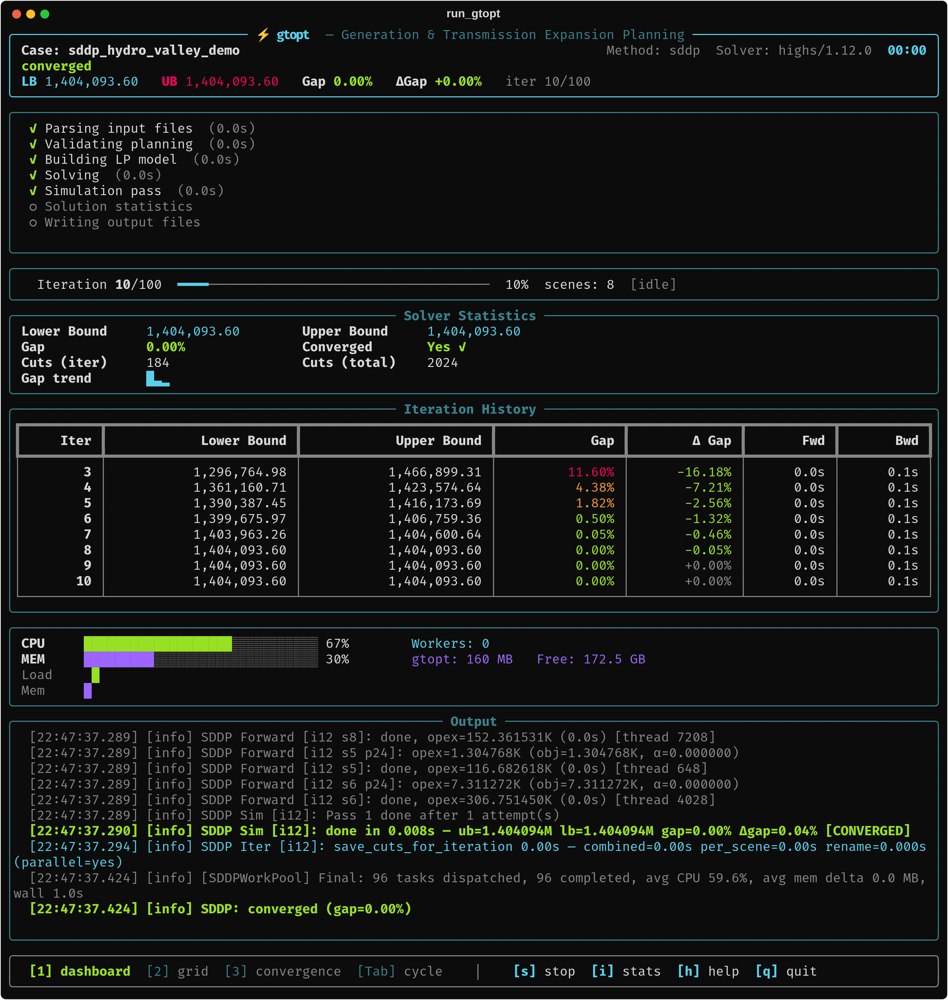
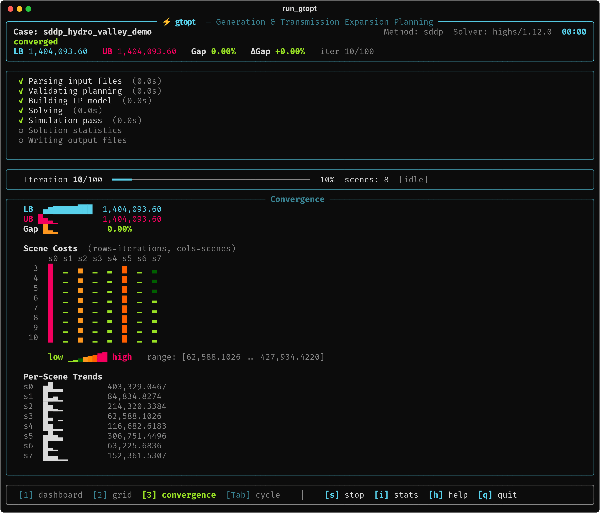

# GTOpt Python Scripts

The `scripts/` directory contains Python command-line utilities for
preparing, converting, visualizing, and post-processing data for use with GTOpt.

> **Detailed documentation** for each script is available in the
> [`docs/scripts/`](scripts/) directory. This page provides a summary
> with links to the full documentation.

## Table of Contents

- [Installation](#installation)
- [Public tools at a glance](#public-tools-at-a-glance)
- [Supported source versions](#supported-source-versions)
- **Data Preparation & Conversion**
  - [gtopt_diagram](#gtopt_diagram) · [full docs](scripts/gtopt_diagram.md)
  - [plp2gtopt](#plp2gtopt) · [full docs](scripts/plp2gtopt.md)
  - [gtopt-fetch](#gtopt-fetch)
  - [plexos2gtopt](scripts/plexos2gtopt.md) — PLEXOS XML / CEN PCP bundles,
    typical weeks / days
  - [sddp2gtopt](#sddp2gtopt) · [full docs](scripts/sddp2gtopt.md)
  - [psse2gtopt](#psse2gtopt) · [full docs](scripts/psse2gtopt.md)
  - [pp2gtopt](#pp2gtopt) · [full docs](scripts/pp2gtopt.md)
  - [nrel118_to_gtopt](#nrel118_to_gtopt) · [full docs](scripts/nrel118_to_gtopt.md)
  - [cucdata2gtopt](#cucdata2gtopt) · [full docs](scripts/cucdata2gtopt.md)
  - [sienna2gtopt](#sienna2gtopt) · [full docs](scripts/sienna2gtopt.md)
  - [gasnet2gtopt](scripts/gasnet2gtopt.md) — gas networks with native gas elements
  - [dlr2gtopt](scripts/dlr2gtopt.md) — dynamic line rating inputs (critical spans)
  - [tcheby2gtopt](scripts/tcheby2gtopt.md) — Chebyshev point-stage test cases
    (`python -m`)
  - [rts_gmlc_to_gtopt](scripts/rts_gmlc_to_gtopt.md) — RTS-GMLC emission /
    reserve benchmark (`python -m`)
  - [gtopt2pp](#gtopt2pp) — convert gtopt JSON back to pandapower
  - [igtopt](#igtopt) · [full docs](scripts/igtopt.md) · [Excel
    template](templates/gtopt_template.xlsx) · `igtopt --make-template`
    regenerates the template
  - [cvs2parquet](#cvs2parquet) · [full docs](scripts/cvs2parquet.md)
  - [ts2gtopt](#ts2gtopt) · [full docs](scripts/ts2gtopt.md)
  - [gtopt_compare](#gtopt_compare) · [full docs](scripts/gtopt_compare.md)
- **Running & Monitoring**
  - [run_gtopt](#run_gtopt) — smart solver wrapper with pre/post-flight checks
  - [gtopt_monitor](#gtopt_monitor) — live solver convergence dashboard
- **Validation & Diagnostics**
  - [gtopt_check_json](#gtopt_check_json) — validate JSON planning files
  - [gtopt_check_lp](#gtopt_check_lp) — diagnose infeasible LP files
  - gtopt_check_topology — network islands per stage, KVL loops, bridges · [full
    docs](scripts/gtopt_check_topology.md)
  - [gtopt_check_output](#gtopt_check_output) — analyze solver output
  - [gtopt_check_solvers](#gtopt_check_solvers) — discover and validate LP
    solver plugins
  - [gtopt_compress_lp](#gtopt_compress_lp) — compress LP debug files
  - [gtopt_check_fingerprint](#gtopt_check_fingerprint) — LP structural
    fingerprint verification · [full docs](lp-fingerprint.md)
  - [gtopt_check_pampl](#gtopt_check_pampl) — validate PAMPL expression syntax
    and LP resolution
  - [gtopt_check_cases](#gtopt_check_cases) — check a case collection
    (`gtopt-cases`) against its catalog
  - [plp_compress_case](#plp_compress_case) — compress PLP case files
- **Utilities**
  - [gtopt_config](#gtopt_config) — unified configuration for all tools
  - [gtopt_field_extractor](#gtopt_field_extractor) (developer tool, `python -m`)
- [Tool Comparison (gtopt vs PLP vs pandapower)](tools/comparison.md)
- [Using with gtopt\_guisrv and gtopt\_websrv](#using-with-gtopt_guisrv-and-gtopt_websrv)

---

## Installation

Install all tools with a single `pip` command from the repository root:

```bash
pip install ./scripts
```

This registers every **public** command-line tool on your `PATH` — the
authoritative list is `[project.scripts]` in `scripts/pyproject.toml`,
summarised in [Public tools at a glance](#public-tools-at-a-glance).
Every one of them is exercised by `scripts/tests/test_public_cli.py`
(`--help` plus an end-to-end run on a tiny case).  An editable install is
useful during
development:

```bash
pip install -e "./scripts[dev]"
```

### Bundled data files

Several tools read non-Python data files at runtime.  They ship inside
the Python packages (declared in `[tool.setuptools.package-data]` of
`scripts/pyproject.toml`), so a regular `pip install ./scripts` and an
editable install see exactly the same files:

| File | Used by |
|------|---------|
| `plexos2gtopt/data/cen_pcp_hard_ucs.txt` | PLEXOS-HARD user-constraint list (`plexos2gtopt`, `python -m plexos2gtopt.uc_audit`) |
| `gtopt_shared/data/emissions/cen_chile.json` | default `--emissions-file` of `plexos2gtopt` |
| `gtopt_shared/data/ipcc_emission_factors.json` | IPCC-2006 emission defaults |
| `gtopt_shared/data/cogen/cen_chile_cogen.csv` | CEN cogen list (`plexos2gtopt`, `plp2gtopt`, `gtopt_marginal_units`) |
| `{plexos2gtopt,plp2gtopt}/solvers/*.prm`, `*.opts` | solver parameter files copied into each converted case |
| `gtopt_expand/templates/*` | PAMPL/TSON templates, RoR and pmin-as-flowright whitelists |

A missing data file is a hard error (`MissingDataFileError`, a
`FileNotFoundError`) — the tools never silently fall back to a default
that changes the model.  Wheels built before 2026-11 lacked most of
these files: `plexos2gtopt` then demoted ~100 CEN user constraints from
hard to soft, used the bare IPCC emission factors, tagged no cogen
units and wrote no `solvers/` directory.  Reinstall with:

```bash
pip install --force-reinstall --no-deps ./scripts   # regular install
# or, for development:
pip install -e "./scripts[dev]"
```

`pytest -m wheel gtopt_shared/tests/test_wheel_package_data.py` builds a
wheel, installs it into a throwaway venv and checks every bundled file
(see `gtopt_shared.resources.REQUIRED_DATA_FILES`).  New runtime data
files go under `<package>/data/`, `solvers/` or `templates/`, must be
added to the package-data globs and to `REQUIRED_DATA_FILES`, and should
be located via `gtopt_shared.resources.package_data_file()`.

Optional extras unlock additional output formats:

```bash
pip install -e "./scripts[dev,diagram]"
# adds: graphviz, pyvis, cairosvg
```

### Public tools at a glance

One line per console script installed by `pip install ./scripts`:

| Command | Purpose | Docs |
|---------|---------|------|
| `plp2gtopt` | PLP (`plp*.dat`) case → gtopt JSON + Parquet | [plp2gtopt](scripts/plp2gtopt.md) |
| `plexos2gtopt` | PLEXOS XML / CEN PCP bundle → gtopt JSON | [plexos2gtopt](scripts/plexos2gtopt.md) |
| `plexos2gtopt-line-lifts` | Rank binding lines of a solved PLEXOS-derived case to choose `--lift-line-caps` | [plexos2gtopt](scripts/plexos2gtopt.md) |
| `sddp2gtopt` | PSR SDDP/NCP case → gtopt JSON | [sddp2gtopt](scripts/sddp2gtopt.md) |
| `psse2gtopt` | PSS®E RAW → gtopt DC OPF case | [psse2gtopt](scripts/psse2gtopt.md) |
| `gasnet2gtopt` | `*.gasnet.json` gas network + power system → gtopt JSON with native gas elements | [gasnet2gtopt](scripts/gasnet2gtopt.md) |
| `pp2gtopt` | pandapower network → gtopt JSON | [pp2gtopt](scripts/pp2gtopt.md) |
| `gtopt2pp` | gtopt JSON → pandapower network | [gtopt2pp](#gtopt2pp) |
| `nrel118_to_gtopt` | NREL-118 test system → multi-stage gtopt case | [nrel118_to_gtopt](scripts/nrel118_to_gtopt.md) |
| `sienna2gtopt` | Sienna (PowerSimulations.jl) reference systems → gtopt JSON (`sienna_to_gtopt` is a deprecated alias) | [sienna2gtopt](scripts/sienna2gtopt.md) |
| `cucdata2gtopt` | Clustered-UC benchmark (Morales-España & Tejada-Arango 2019, IEEE 39/118-bus) → gtopt IUC case | [cucdata2gtopt](scripts/cucdata2gtopt.md) |
| `dlr2gtopt` | Towers + weather → IEEE 738 span ratings → critical spans (Matus et al. 2012) → `Line.dlr` input | [dlr2gtopt](scripts/dlr2gtopt.md) |
| `tcheby2gtopt` | tcheby SQLite test systems → gtopt JSON (hourly block and Chebyshev point-stage cases) | [tcheby2gtopt](scripts/tcheby2gtopt.md) |
| `rts_gmlc_to_gtopt` | RTS-GMLC test system → single-day gtopt dispatch case with emissions, reserves and inertia | [rts\_gmlc\_to\_gtopt](scripts/rts_gmlc_to_gtopt.md) |
| `igtopt` | Excel workbook → gtopt JSON (and `--make-template`) | [igtopt](scripts/igtopt.md) |
| `cvs2parquet` | CSV → Parquet converter for gtopt input tables | [cvs2parquet](scripts/cvs2parquet.md) |
| `ts2gtopt` | Project time series onto a gtopt block horizon | [ts2gtopt](scripts/ts2gtopt.md) |
| `gtopt_expand` | Expansion transforms: LNG terminal, ROR promotion, pumped storage, irrigation agreements | [irrigation](irrigation-agreements.md) |
| `gtopt-net` | Network reduction (reduce / project results / cascade run) | [proposal](network_reduction_proposal.md) |
| `run_gtopt` | Smart gtopt wrapper with pre/post-flight checks | [run_gtopt](#run_gtopt) |
| `gtopt_monitor` | Live solver status dashboard (GUI or `--no-gui`) | [gtopt_monitor](#gtopt_monitor) |
| `gtopt_check_json` | Validate a gtopt planning JSON | [gtopt_check_json](#gtopt_check_json) |
| `gtopt_check_topology` | Pre-flight network topology analysis (per-stage islands, KVL loops) | [gtopt_check_topology](scripts/gtopt_check_topology.md) |
| `gtopt_check_pampl` | Validate PAMPL/TAMPL user-constraint files | [gtopt_check_pampl](#gtopt_check_pampl) |
| `gtopt_check_lp` | Diagnose infeasible LP files | [gtopt_check_lp](#gtopt_check_lp) |
| `gtopt_check_output` | Analyse a gtopt output directory | [gtopt_check_output](#gtopt_check_output) |
| `gtopt_check_solvers` | Discover and validate LP solver plugins | [gtopt_check_solvers](#gtopt_check_solvers) |
| `gtopt_check_fingerprint` | Compute / verify / compare LP structural fingerprints | [lp-fingerprint](lp-fingerprint.md) |
| `gtopt_check_cases` | Check a case collection (`gtopt-cases`) against its catalog | [gtopt_check_cases](#gtopt_check_cases) |
| `gtopt_compress_lp` | Compress LP debug files | [gtopt_compress_lp](#gtopt_compress_lp) |
| `gtopt_compare` | Compare gtopt results with pandapower / PLP references | [gtopt_compare](scripts/gtopt_compare.md) |
| `gtopt_diagram` | Network topology and planning-structure diagrams | [gtopt_diagram](scripts/gtopt_diagram.md) |
| `gtopt_results_summary` | Summarise a gtopt output directory | — |
| `gtopt_pricing_uplift` | Make-whole and lost-opportunity uplift and price statistics of unit-commitment runs (compare `pricing_mode`s) | [Pricing modes](unit-commitment.md#111-pricing-modes) |
| `gtopt_timeseries_export` | Export gtopt results as tidy time series | — |
| `gtopt2pbi` | Reshape gtopt Parquet outputs for Power BI | — |
| `gtopt-marginal-units` | Marginal-unit / marginal-emission identification from gtopt results | [plan](scripts/gtopt_marginal_units_plan.md) |
| `plp_compress_case` | Compress / decompress PLP case directories | [plp_compress_case](#plp_compress_case) |
| `plexos_compress_case` | Compress / decompress PLEXOS bundle directories | — |
| `cen_demanda` | Download CEN SIPUB hourly demand data | — |
| `cen2gtopt` | Fetch CEN real-operation data into a canonical feed | [review](scripts/cen_marginal_emissions_review.md) |
| `cen2gtopt-marginal-period` | Multi-day CEN marginal-unit runs → Parquet dataset | [review](scripts/cen_marginal_emissions_review.md) |
| `cen2gtopt-buses` | CEN bus catalogue and operational islands | [review](scripts/cen_marginal_emissions_review.md) |
| `cen2gtopt-cache` | Inspect / pre-warm the CEN download cache | [review](scripts/cen_marginal_emissions_review.md) |
| `gtopt-fetch` | Download operator data (CEN, AMM, EOR, AEMO, …) through the source registry, with a checksummed cache | [gtopt-fetch](#gtopt-fetch) |
| `cen2gtopt-pcp-archive` | Download CEN PCP base / solution bundles (deprecated: use `gtopt-fetch cen`) | [review](scripts/cen_marginal_emissions_review.md) |
| `cen2gtopt-pcp-inputs` | Read CEN PCP LP-input CSV bundles | [review](scripts/cen_marginal_emissions_review.md) |
| `cen2gtopt-pcp-solution` | Read CEN PCP `.accdb` solution files (needs `mdbtools`) | [review](scripts/cen_marginal_emissions_review.md) |

Two converters have no console script; they are installed with the
package and run as modules:

| Module | Purpose | Docs |
|--------|---------|------|
| `python -m tcheby2gtopt` | Chebyshev scheduling SQLite test systems → hourly-block and Chebyshev point-stage cases; rebuilds `cases/cheby_small` | [tcheby2gtopt](scripts/tcheby2gtopt.md) |
| `python -m rts_gmlc_to_gtopt` | RTS-GMLC → single-bus 24 h case with per-generator multi-pollutant emissions, optional reserves and inertia | [rts_gmlc_to_gtopt](scripts/rts_gmlc_to_gtopt.md) |

### Supported source versions

Every input converter declares the versions of its source tool or format
it supports and the subset the repository's tests or cases exercise
(`SOURCE_FORMAT`, built on `gtopt_shared.source_versions`).  At run time it
detects the input's version when the input carries one, logs the
resolution (and records it in its provenance file where it has one), and
warns on an untested version or an unknown one, which falls back to the
closest supported version.  `--source-version X` overrides the detection;
`--help` prints the list below for each tool.  `plp2gtopt`, whose
source has no version numbers, declares known *variants* instead: several
may apply at once and an unsupported one is ignored with a warning.

| Converter | Source | Supported | Tested | Detected from | Recorded in |
|-----------|--------|-----------|--------|---------------|-------------|
| `plp2gtopt` | PLP Fortran `.dat` (known variants) | `CEN65`, `ESS`, `BESS`, `maule-agreement`, `laja-agreement`, `cenfi-legacy`, `cenfi-segmented`, `cuts-plpplaem`, `cuts-plpplem` | all | files present / layouts (`plpstrcen.dat` → unsupported `PLPv6.1-strcen`); several tags at once | log, `plp2gtopt_state.json` |
| `sddp2gtopt` | PSR SDDP / NCP `.dat` | `16`, `17` | `16`, `17` | a `!Code,` CSV header → 17; else undetectable | log |
| `psse2gtopt` | PSS®E RAW | `32`, `33` | `32`, `33` | `REV` field of the case-id line | log |
| `pp2gtopt` | pandapower | `2.13`, `2.14`, `3.0`–`3.5` | `3.4`, `3.5` | `net.version` | log, `pp2gtopt_state.json` (time-series mode) |
| `cen2gtopt` | CEN SIP API | `4` | `4` (recorded fixtures) | endpoint versions in a `--cache` fetch cache | log, `manifest.json` |
| `rts_gmlc_to_gtopt` | RTS-GMLC release | `0.2.3` | `0.2.3` (slow CTest) | `SOURCE_VERSION` marker of a fresh cache | log, summary line |
| `sienna2gtopt` | PowerSystemsTestData commit | `a2ecae9…` | `a2ecae9…` | bundle files matching the manifest SHA-256 | log |
| `cucdata2gtopt` | CUC-data commit | `624abbb…` | `624abbb…` (synthetic workbook + cached data) | files matching the manifest SHA-256 | log |
| `nrel118_to_gtopt` | PowerSystemsTestData commit | `a2ecae9…` | none | `SOURCE_REF` marker of a fresh cache, or a checkout's `HEAD` | log, `nrel118_to_gtopt_state.json` |
| `gasnet2gtopt` | `*.gasnet.json` schema | `1` | `1` | optional top-level `schema_version` | log, `.meta.json` |

`plexos2gtopt` adopts the same helper separately.  `ts2gtopt` and
`cvs2parquet` read plain CSV / Parquet tables and gtopt's own JSON, which
have no versioned source format.  Per-tool details: the "Supported source
versions" section of each tool's page.

### Developer tools (not installed as commands)

Repository-maintenance helpers stay importable but are **not** console
scripts; run them from `scripts/` with `python -m`:

| Module | Purpose |
|--------|---------|
| `python -m gtopt_field_extractor` | Generate field-reference tables from the C++ headers (needs the source tree) |
| `python -m cen2gtopt.marginal_units` | Single-day marginal-unit diagnostic (hard-coded date; research use) |
| `python -m cen2gtopt.pcp_validate` | Back-test the marginal-emission pipeline against CEN's PCP solution |

The former aliases `sddp_monitor` (use `gtopt_monitor`) and
`gtopt_irrigation` (use `gtopt_expand`) were removed.  Other developer
tools live in [`tools/`](../tools/README.md).

### Package organization

Each tool lives in its own Python package directory under `scripts/`
(`scripts/<package>/`, with tests in `scripts/<package>/tests/`); shared
code is in `gtopt_shared/`, `gtopt_config/` and `gtopt_writer/`.

### Dependencies

| Package | Purpose |
|---------|---------|
| `numpy` | Numerical array processing |
| `pandas` | DataFrame I/O |
| `pyarrow` | Parquet read/write |
| `openpyxl` | Excel file support (`igtopt`) |
| `pandapower` | Power system network data (`pp2gtopt`, `gtopt2pp`, `gtopt_compare`) |
| `rich` | Styled terminal output (`gtopt_check_json`, `plp2gtopt`, `igtopt`, `run_gtopt`) |
| `matplotlib` *(optional)* | live charts (`gtopt_monitor` GUI mode) |
| `graphviz` *(optional)* | SVG/PNG/PDF rendering (`gtopt_diagram`) |
| `pyvis` *(optional)* | Interactive HTML diagrams (`gtopt_diagram`) |
| `cairosvg` *(optional)* | High-res PNG/PDF export (`gtopt_diagram`) |

---

## gtopt_diagram

> **[→ Full documentation](scripts/gtopt_diagram.md)**

Generates **network topology and planning-structure diagrams** from a GTOpt
JSON planning file.  Supports multiple output formats (SVG, PNG, PDF, DOT,
Mermaid, interactive HTML) and automatic simplification of large cases via
aggregation modes.


### Basic usage

```bash
# Auto mode (default) – picks the best aggregation for your case size
gtopt_diagram cases/ieee_9b/ieee_9b.json -o ieee9b.svg

# Interactive HTML with physics simulation
gtopt_diagram cases/ieee_9b/ieee_9b.json --format html -o ieee9b.html

# Mermaid Markdown snippet (no extra dependencies)
gtopt_diagram cases/ieee_9b/ieee_9b.json --format mermaid

# Network-only: no generator nodes (clean topology view)
gtopt_diagram large_case.json --no-generators -o topo.svg

# Planning time-structure diagram
gtopt_diagram cases/c0/system_c0.json --diagram-type planning --format html
```

### Output formats (`--format`)

| Format | Description | Requires |
|--------|-------------|----------|
| `svg` | Scalable vector graphic (default) | `graphviz` |
| `png` | Raster image | `graphviz` + `cairosvg` |
| `pdf` | PDF document | `graphviz` + `cairosvg` |
| `dot` | Graphviz DOT source | — (no extra deps) |
| `mermaid` | Mermaid flowchart source | — (no extra deps) |
| `html` | Interactive vis.js browser diagram | `pyvis` |

### Aggregation modes (`--aggregate`)

| Mode | When auto selects it | Description |
|------|---------------------|-------------|
| `auto` | (default) | Chooses based on element count |
| `none` | < 100 elements | Every generator shown individually |
| `bus` | 100–999 elements | One summary node per bus |
| `type` | ≥ 1000 elements | One node per (bus, generator-type) pair |
| `global` | — (manual only) | One node per generator type, system-wide |

### Reducing large diagrams

```bash
# Keep only buses ≥ 220 kV (lump low-voltage buses into HV neighbours)
gtopt_diagram large_case.json --voltage-threshold 220 -o hv_topo.svg

# Show only hydro generators within 3 hops of a specific bus
gtopt_diagram large_case.json --filter-type hydro --focus-bus Chapo220 --focus-hops 3

# Hard node-count cap: escalate aggregation until ≤ 50 nodes remain
gtopt_diagram large_case.json --max-nodes 50 -o compact.svg

# Keep only the top-2 generators per bus by pmax
gtopt_diagram large_case.json --top-gens 2 -o top2.svg
```

### Visual features

- **Voltage-based line coloring**: transmission lines are drawn with color
  intensity and width proportional to the bus voltage level (higher voltage
  lines appear darker and wider).
- **Reservoir sizing**: reservoir nodes are scaled by their storage capacity
  (`emax`), so larger reservoirs appear visually larger in the diagram.
- **Reserve zones and provisions**: `reserve_zone_array` entries are rendered
  as zone nodes connected to the generators that provide reserves via
  `reserve_provision_array`.
- **Generator and demand profiles**: `generator_profile_array` and
  `demand_profile_array` entries are rendered as profile nodes linked to
  their parent generator or demand.
- **Colorblind palette**: use `--palette colorblind` to switch all element
  colors to a palette designed for color-vision deficiency accessibility.

### File-referenced value resolution

When fields like `pmax` or `lmax` are stored as Parquet file references,
`gtopt_diagram` resolves them using `--scenario`, `--stage`, and `--block`
(all default to UID 1).  This controls which row of the Parquet file is
used for sizing and labeling diagram elements.

### All options

```text
positional arguments:
  json_file             gtopt JSON planning file

options:
  -t, --diagram-type    topology (default) or planning
  -f, --format          dot | png | svg | pdf | mermaid | html  (default: svg)
  -o, --output          output file path
  -s, --subsystem       full | electrical | hydro  (default: full)
  -L, --layout          dot | neato | fdp | sfdp | circo | twopi
  -d, --direction       LR | TD | BT | RL  (Mermaid direction, default: LR)
  --clusters            Group in Graphviz sub-clusters
  --palette             default | colorblind  (default: default)
  --scenario UID        Scenario UID for resolving file-referenced values (default: 1)
  --stage UID           Stage UID for resolving file-referenced values (default: 1)
  --block UID           Block UID for resolving file-referenced values (default: 1)

reduction options:
  -a, --aggregate       auto | none | bus | type | global  (default: auto)
  --no-generators       Omit all generator nodes
  -g, --top-gens N      Keep only top-N generators per bus by pmax
  --filter-type TYPE    Show only: hydro solar wind thermal battery
  --focus-bus BUS       Show only elements within N hops of BUS (repeatable)
  --focus-generator GEN Focus on bus(es) connected to these generators (by name or uid)
  --focus-area KV       Focus on buses at or above this voltage level (kV)
  --focus-hops N        Hops for --focus-bus (default: 2)
  --max-nodes N         Hard cap; escalate aggregation until ≤ N nodes
  -V, --voltage-threshold KV  Lump buses below KV into HV neighbours
  --hide-isolated       Remove unconnected nodes
  --compact             Omit detail labels (names/counts only)
```

---

## plp2gtopt

> **[→ Full documentation](scripts/plp2gtopt.md)**

Converts a **PLP** (*Programación de Largo Plazo*) case directory to the GTOpt
JSON + Parquet
format.  Reads the standard PLP data files (`plpblo.dat`, `plpbar.dat`,
`plpcosce.dat`, `plpcnfce.dat`, `plpcnfli.dat`, `plpdem.dat`, `plpeta.dat`,
and others) and writes:

- A **GTOpt JSON file** (`<output-dir>.json`) with the complete system,
  simulation, and options configuration.
- **Parquet time-series files** organised in subdirectories under
  `<output-dir>/` (e.g. `Demand/lmax.parquet`, `Generator/pmin.parquet`,
  `Afluent/afluent.parquet`).

### Hydro system conversion

When `plpcnfce.dat` contains reservoir (*embalse*) or series (*serie*)
centrals, `plp2gtopt` converts the cascaded hydro system into GTOpt arrays.
Two additional **optional** PLP files extend the hydro model:

| PLP file | GTOpt array | Description |
|----------|-------------|-------------|
| `plpcnfce.dat` | `junction_array`, `waterway_array`, `turbine_array`, `reservoir_array`, `flow_array` | Main hydro topology (required when hydro centrals exist) |
| `plpcenre.dat` | `reservoir_production_factor_array` | Volume-dependent turbine production factor (PLP *rendimiento*): piecewise-linear conversion rate as a function of reservoir storage |
| `plpcenfi.dat` | `reservoir_seepage_array` | Waterway-to-reservoir seepage (PLP *filtración*): linear model `flow = slope × volume + constant` |

Both `plpcenre.dat` and `plpcenfi.dat` are **optional** — if absent, the
corresponding arrays are simply not written.  When present and non-empty they
are silently parsed and appended to the JSON output.

**`plpcenre.dat` format** (*Archivo de Rendimiento de Embalses*):

```text
# Number of entries
N
# For each entry:
'CENTRAL_NAME'     ← turbine (central) name
'EMBALSE_NAME'     ← reservoir name
mean_production_factor    ← fallback production factor [MW·s/m³]
num_segments       ← number of piecewise-linear segments
idx  volume  slope  constant  scale  ← one line per segment
```

**`plpcenfi.dat` format** (*Archivo de Centrales Filtración*):

```text
# Number of entries
N
# For each entry:
'CENTRAL_NAME'     ← waterway source central name
'EMBALSE_NAME'     ← receiving reservoir name
slope  constant    ← seepage model [m³/s/dam³] and [m³/s]
```

### Basic usage

```bash
# Default: reads ./input, writes ./output/output.json + data in ./output/
plp2gtopt

# Explicit input/output directories
plp2gtopt -i plp_case_dir -o gtopt_case_dir

# Limit conversion to the first 5 stages
plp2gtopt -i input/ -s 5

# Single hydrology (1-based; the default is all hydrologies)
plp2gtopt -i input/ -y 1

# Two hydrology scenarios (1-based) with 60/40 probability split
plp2gtopt -i input/ -y 1,2 -p 0.6,0.4

# Range selector: hydrologies 1, 2, and 5 through 10
plp2gtopt -i input/ -y 1,2,5-10

# Group PLP stages 1–4 into phase 1, then one stage per phase after
plp2gtopt -i input/ --stages-phase '1:4,5,6,7,8,9,10,...'

# Apply a 10% annual discount rate
plp2gtopt -i input/ -d 0.10

# Verbose debug output
plp2gtopt -i input/ -l DEBUG
```

### Hydrology index format (`-y` / `--hydrologies`)

Hydrology indices follow the **Fortran 1-based convention**: index `1` refers
to the first hydrology column in the PLP data files.  The argument accepts
comma-separated values and ranges:

| Syntax | Meaning |
|--------|---------|
| `all` | Every hydrology (default) |
| `first` | The first available hydrology (same as `--first-scenario`) |
| `1` | Hydrology 1 only |
| `1,2` | Hydrologies 1 and 2 |
| `1,2,5-10` | Hydrologies 1, 2, and 5 through 10 |
| `1,2,5-10,11` | Hydrologies 1, 2, 5-10, and 11 |

The internal 0-based index stored in the output JSON (`"hydrology"` field in
`scenario_array`) is automatically computed as `input_index - 1`.

### Phase layout (`--stages-phase`)

By default, phase assignment is controlled by `-M` / `--method`
(default `cascade`):
- `sddp`, `cascade`, `cascade-reduced`: one phase per PLP stage
- `monolithic` (`mono` is a deprecated alias): one phase covering all
  stages

The `-g` / `--stages-phase` option overrides this with an explicit mapping.  Tokens
are comma-separated and use 1-based PLP stage indices:

| Token | Meaning |
|-------|---------|
| `N` | Single stage N as one phase |
| `N:M` | Stages N through M (inclusive) as one phase |
| `...` | (trailing) auto-expand one stage per phase for remaining stages |

```bash
# Stages 1-4 as phase 1, stages 5-10 each as their own phase,
# then one stage per phase for any remaining stages
plp2gtopt -i input/ --stages-phase '1:4,5,6,7,8,9,10,...'

# Group all stages into two phases: 1-12 and 13-24
plp2gtopt -i input/ --stages-phase '1:12,13:24'
```

### Pasada (run-of-river) modeling (`--pasada-mode`)

`--pasada-mode` selects how PLP *pasada* (run-of-river) centrals are
modelled:

| Mode | Effect |
|------|--------|
| `auto` (default) | per central: solar / wind → generator profile, hydro → flow + turbine |
| `hydro` | full hydro topology (junctions, waterways, turbines, flows) |
| `flow-turbine` | every pasada central as a simplified flow + turbine |
| `profile` | every pasada central as a generator profile (normalised capacity factors) |

### Block-to-hour map (`indhor.csv`)

When the PLP input directory contains `indhor.csv`, `plp2gtopt` reads it and
writes a normalised `BlockHourMap/block_hour_map.parquet` file alongside the
other Parquet outputs.  A `"block_hour_map"` key is added to the simulation
section of the output JSON so that post-processing tools (e.g. `ts2gtopt`)
can reconstruct hourly time-series from block-granularity solver output.

The `indhor.csv` format has columns:
`Año, Mes, Dia, Hora, Bloque` (all integers; `Hora` is 1-based 1-24).

### ZIP output (`-z` / `--zip`)

The `-z` flag creates a single **ZIP archive** that bundles the JSON
configuration file and all Parquet/CSV data files together, preserving the
full output directory structure.  This archive is directly compatible with
**gtopt\_guisrv** (upload via the GUI) and **gtopt\_websrv** (submit via the
REST API):

```bash
plp2gtopt -z -i plp_case -o my_case
# Produces: my_case.zip
```

The ZIP layout is:

```text
my_case.zip
├── my_case.json
└── my_case/              ← every file of the output directory
    ├── my_case.json      ← main system/simulation/options config
    ├── Demand/
    │   └── lmax.parquet
    ├── Generator/
    │   └── pmax.parquet
    └── Flow/
        └── discharge.parquet
```

The JSON inside `my_case/` uses `input_directory: "."`, so the
data files resolve relative to it.

### Conversion statistics

After a successful conversion, `plp2gtopt` logs statistics (at INFO level)
similar to the pre-solve statistics printed by the `gtopt` solver:

```text
=== System statistics ===
  System name     : plp2gtopt
=== System elements  ===
  Buses           : 2
  Generators      : 3
  Generator profs : 1
  Demands         : 2
  Lines           : 1
  Batteries       : 0
  Converters      : 0
  Junctions       : 2
  Waterways       : 1
  Reservoirs      : 1
  Turbines        : 1
=== Simulation statistics ===
  Blocks          : 8760
  Stages          : 5
  Scenarios       : 2
=== Key options ===
  use_single_bus  : False
  scale_objective : 1000
  demand_fail_cost: 1000
  input_directory : my_case
  annual_discount : 0.1
=== Conversion time ===
  Elapsed         : 1.234s
```

Use `-l DEBUG` to also see which individual `.dat` files are being parsed.

### Common options

`plp2gtopt` has well over 100 options (`plp2gtopt --help`); the most
used ones are below.  The [full documentation](scripts/plp2gtopt.md)
lists the rest (SDDP / cascade tuning, maintenance and works plans,
failure tiers, solver files, …).

| Flag | Default | Description |
|------|---------|-------------|
| `-i, --input-dir DIR` | `input` | PLP input directory |
| `-o, --output-dir DIR` | `output` (`gtopt_NAME` for input `plp_NAME`) | Output directory for the JSON and data files |
| `-f, --output-file FILE` | `<output-dir>/<output-dir-name>.json` | JSON output file path |
| `-F, --output-format {parquet,csv}` | `parquet` | Data file format |
| `-z, --zip` | off | Create a ZIP archive of the JSON + data files |
| `-s, --last-stage N` | all | Stop after stage N |
| `-t, --last-time T` | all | Include stages up to an accumulated time (hours, or `1y`, `6m`, …) |
| `-d, --discount-rate RATE` | `0.0` | Annual discount rate (e.g. `0.10` for 10%) |
| `-m, --management-factor F` | `0.0` | Demand reduction fraction in [0, 1) |
| `-c, --compression ALG` | `zstd` | Output file compression |
| `-y, --hydrologies SPEC` | `all` | Hydrology selector (1-based; `all`, `first`, `1,2,5-10`) |
| `-p, --probability-factors P1[,P2,…]` | equal | Probability weights per scenario |
| `-M, --method METHOD` | `cascade` | `sddp`, `cascade`, `cascade-reduced`, `monolithic` |
| `-g, --stages-phase SPEC` | per `--method` | Explicit phase layout; comma-separated stage indices/ranges with optional `...` wildcard |
| `--pasada-mode MODE` | `auto` | Run-of-river modelling (see above) |
| `--stationary-tol TOL` | `--convergence-tol` | Secondary convergence tolerance for stationary-gap detection |
| `--stationary-window N` | not set (gtopt uses 4) | Iterations to look back when checking gap stationarity |
| `-l, --log-level LEVEL` | `INFO` | Verbosity (`DEBUG`, `INFO`, `WARNING`, `ERROR`) |
| `-V, --version` | — | Print version and exit |

### Isolated centrals

During hydro topology conversion, PLP centrals that have no bus assignment
(`bus <= 0`), no waterway connections, and are not referenced by any other
central are considered **isolated** and are silently skipped.  After the
conversion statistics, a "Skipped Centrals" section lists all isolated
centrals by name so the user can verify that they are genuinely unused.

### Error messages

`plp2gtopt` raises descriptive errors for common problems:

| Situation | Error message |
|-----------|---------------|
| Input directory missing | `Input directory does not exist: 'plp_case/'` |
| Required `.dat` file missing | `Required file not found: …/plpblo.dat` |
| Invalid data format | `Invalid data format: …` |

---

## gtopt-fetch

Common download CLI over the per-operator source registries
(`scripts/gtopt_operators/<op>/sources.toml`; design in
[operator-split](design/operator-split.md)).  The registry holds only
URLs, file-name patterns and the *names* of the environment variables
that carry API keys: keys are never stored in the repository and never
logged.

```bash
gtopt-fetch operators                              # registered operators
gtopt-fetch cen list                               # datasets of the CEN
gtopt-fetch cen info pcp                           # URL, terms, credential
export GTOPT_CEN_PORTAL_KEY=...                    # portal browse key
gtopt-fetch cen get pcp --date 2026-04-22 --out case/source
gtopt-fetch cen get plp_inputs --date 2026-05-15   # bundle in force
gtopt-fetch verify case/source                     # sha256 vs MANIFEST.jsonl
```

- Cache: `$GTOPT_FETCH_CACHE` (default `~/.cache/gtopt/fetch`), one
  directory per `<operator>/<dataset>` with a `MANIFEST.jsonl` (file,
  sha256, size, URL without query string, fetched/published dates).
  Files already downloaded by `cen2gtopt-pcp-archive` are reused.
- `--out DIR` hard-links the files into `DIR` and writes the manifest
  there; `gtopt-fetch verify DIR --write-lock` pins them in a
  `sources.lock` (`sha256sum` format) for a case repository.
- Datasets whose source forbids redistribution (AEMO workbooks and
  models) are `manual`: `get` prints the page and the terms (exit 3);
  download the file yourself and register it with `--file`.  Never
  commit those files.
- Exit status: 0 ok, 1 error, 2 missing credential, 3 manual download
  required.
- TLS: every operator client (`gtopt-fetch`, `cen2gtopt*`) verifies
  server certificates.  Set `GTOPT_CA_BUNDLE=/path/ca.pem` behind a
  proxy or private CA; `GTOPT_INSECURE_TLS=1` turns verification off
  (local debugging only, logged as a warning).  Public intermediate
  certificates that a server omits from its chain ship in
  `gtopt_operators/<op>/certs/`.

## sddp2gtopt

> **[→ Full documentation](scripts/sddp2gtopt.md)**

Converts a **PSR SDDP** (*Stochastic Dual Dynamic Programming*, by
PSR Inc.) case directory to a GTOpt JSON planning, mirroring the
role `plp2gtopt` plays for PLP cases.  v0 is JSON-first: it reads
the typed `psrclasses.json` snapshot the SDDP GUI saves alongside
the Fortran-style `.dat` files, parses the standard PSR collections
(`PSRStudy`, `PSRSystem`, `PSRDemand`, `PSRDemandSegment`, `PSRFuel`,
`PSRThermalPlant`, `PSRHydroPlant`, `PSRGaugingStation`), and writes
a single-bus monolithic GTOpt planning that `gtopt --lp-only`
ingests directly.

> ⚠️  Targets the **PSR Inc. commercial** SDDP format only — *not*
> the academic Julia [SDDP.jl](https://sddp.dev) package.

### Basic usage

```bash
# Inspect a case (no conversion)
sddp2gtopt --info  /path/to/sddp_case

# Schema sanity check
sddp2gtopt --validate /path/to/sddp_case

# Convert (default: writes ./gtopt_<case>/<case>.json)
sddp2gtopt /path/to/sddp_case

# Explicit output dir
sddp2gtopt -i /path/to/sddp_case -o gtopt_case
```

### What gets mapped

| PSR collection                   | GTOpt target                       | Status        |
|----------------------------------|------------------------------------|---------------|
| `PSRStudy`                       | `options` + `simulation`           | ✅            |
| `PSRSystem`                      | synthesised single bus per system  | ✅ (single)   |
| `PSRThermalPlant` + `PSRFuel`    | `generator_array` (`gcost = CEsp × Custo`) | ✅      |
| `PSRHydroPlant`                  | `generator_array` (zero-cost, flat)| ⚠️ flattened  |
| `PSRDemand` + `PSRDemandSegment` | `demand_array` with inline `lmax`  | ✅ (GWh→MW)   |
| `PSRGaugingStation`              | inflow series                      | ⏳ deferred   |
| Multi-system / multi-bus         | extra `bus_array` + `line_array`   | ⏳ deferred   |

The converter's roadmap (hydro reservoir + waterway, multi-bus,
multi-scenario, `.dat` fallback) is tracked in
[`scripts/sddp2gtopt/DESIGN.md`](../scripts/sddp2gtopt/DESIGN.md);
the per-element mapping rules and unit conversions are documented
in detail in [`scripts/sddp2gtopt.md`](scripts/sddp2gtopt.md).

The `sddp2gtopt` front-end auto-detects the input: the typed
`psrclasses.json` snapshot **or** the raw PSR `.dat` collection real
SDDP/NCP deployments ship (e.g. the Guatemalan AMM weekly/daily cases).
The `.dat` path builds a **multi-bus DC OPF** with real thermal merit
costs, per-plant water-value hydro pricing, inflow-limited run-of-river,
and an interconnection import cap (`--import-limit`).

---

## psse2gtopt

> **[→ Full documentation](scripts/psse2gtopt.md)**

Converts a **PSS®E** `.raw` power-flow case (revisions 32/33) into a
single-snapshot **multi-bus DC OPF** GTOpt planning — the sister tool to
`plp2gtopt` / `sddp2gtopt` for the Siemens PSS/E dialect.  Buses → `Bus`,
branches + transformers → `Line` (per-unit reactance; 3-winding → star
bus), generators → `Generator` (uniform `--gcost`, since RAW has no
costs), loads → `Demand`.  Optional AMM side-car inputs: `--nomenclatura`
(readable bus names), `--ldm` (merit-order costs), `--rating-set A|B|C`.

```bash
psse2gtopt --info case.raw                 # case summary
psse2gtopt -i case.raw -o gtopt_case        # convert
gtopt -s gtopt_case/gtopt_case.json --set output_directory=out  # solve DC OPF
```

---

## cucdata2gtopt

> **[→ Full documentation](scripts/cucdata2gtopt.md)**

Converts the case studies of Morales-España & Tejada-Arango, "Modeling
the hidden flexibility of clustered unit commitment" (IEEE TPWRS 2019)
— modified IEEE 39-bus (90 units) and 118-bus (540 units) systems, 24 h,
DC network, up/down reserve — into gtopt individual-unit UC cases.  The
data ([CUC-data](https://github.com/datejada/CUC-data)) has no licence:
it is fetched from a pinned commit into `~/.cache/gtopt/cucdata/` and
never committed.

```bash
cucdata2gtopt --fetch-only                       # prime the cache
cucdata2gtopt --system 39 --reserve 10 -o cuc/   # cuc/cuc39_r10_s10.json
cucdata2gtopt --system 118 --reserve 2.5 --scale 10 -o cuc/
gtopt cuc/cuc39_r10_s10.json --mip-gap 1e-4
```

## sienna2gtopt

> **[→ Full documentation](scripts/sienna2gtopt.md)**

Ports a test case of NREL-Sienna PowerSimulations.jl to a gtopt planning
JSON.  The Sienna data bundle (`5bus`, the only one with the CSV
tables the variants read) is
downloaded from a pinned upstream commit on first use and cached; set
`GTOPT_OFFLINE=1` to forbid downloads.  `sienna_to_gtopt` is kept as a
deprecated alias of the command.

```bash
sienna2gtopt hvdc -o hvdc.json
sienna2gtopt battery_degeneracy --subcase c -o bd_c.json
sienna2gtopt reserves --golden reserves_uc.json --ordc auto -o res.json
```

| Argument | Description |
|----------|-------------|
| `VARIANT` | `battery_degeneracy`, `cascading_hydro`, `fuel_cost_ts`, `hvdc`, `interruptible_load`, `monitored_line`, `pumped_storage`, `reserves`, `wecc_240` |
| `-o, --output FILE` | Output JSON (default `<variant>.json`) |
| `--bundle {5bus,14bus}` | Sienna data bundle; `14bus` holds only `data_14bus_pu.jl` (PowerSystems.jl data, no CSV tables) and is rejected with a usage error |
| `--subcase {b,c,d,e,f}` | `battery_degeneracy` only |
| `--golden FILE` | `reserves` only: a reserve golden written by `tools/sienna_solve_golden.jl`; its system data is the input (unit commitment, range reserves and ORDC) |
| `--ordc {auto,stacked,omit}` | `reserves` only: ORDC as stacked priced reserve zones, omitted, or as in the golden |
| `--source-version X` | Assume this PowerSystemsTestData version |

## nrel118_to_gtopt

> **[→ Full documentation](scripts/nrel118_to_gtopt.md)**

Builds the **NREL-118** extended IEEE 118-bus test system (Peña et al.
2018) as a full-network gtopt case: 118 buses, 186 lines, 327 generators
at their buses, hourly regional load distributed by bus participation
factors (`Demand/lmax.parquet`), hourly wind / solar / hydro
availability (`GeneratorProfile/profile.parquet`) and IPCC AR6 CO₂
factors.  Source CSVs are downloaded on demand (pinned commit) into
`~/.cache/gtopt/nrel118/` and never vendored.

```bash
nrel118_to_gtopt -o nrel118/nrel118.json               # 366 daily stages x 24 h
nrel118_to_gtopt --hours 168+168 -o week2/nrel118.json  # one week
nrel118_to_gtopt --block-hours 4 --stage-hours 168 -o y/nrel118.json
```

---

## pp2gtopt

> **[→ Full documentation](scripts/pp2gtopt.md)**

Converts a **pandapower** network to GTOpt JSON format.  Accepts either a
built-in IEEE test network (via `-n`) or any pandapower network file saved to
disk (via `-f`).  Writes a self-contained GTOpt JSON file ready to be solved
directly with the `gtopt` binary or submitted via `gtopt_guisrv` / `gtopt_websrv`.

### Basic usage

```bash
# Convert the default IEEE 30-bus built-in network → ieee30b.json
pp2gtopt

# Convert a saved pandapower JSON file
pp2gtopt -f my_network.json -o my_case.json

# Convert a MATPOWER case file
pp2gtopt -f case39.m -o case39.json

# Convert a pandapower Excel workbook
pp2gtopt -f network.xlsx -o network.json

# Use a specific built-in test network
pp2gtopt -n case14 -o ieee14b.json

# List all available built-in test networks
pp2gtopt --list-networks
```

### Input from file (`-f / --file`)

`-f FILE` loads any pandapower network saved to disk.  The format is
auto-detected from the file extension:

| Extension | Format | Produced by |
|-----------|--------|-------------|
| `.json` | pandapower JSON | `pandapower.to_json()` |
| `.xlsx` / `.xls` | pandapower Excel | `pandapower.to_excel()` |
| `.m` | MATPOWER case file | MATPOWER / Octave |

The output JSON system `name` is derived from the file stem (e.g. `case39.m`
→ `"case39"`).

### Available built-in networks (`-n / --network`)

| Network name | pandapower function | Description |
|---|---|---|
| `ieee30b` *(default)* | `case_ieee30` | IEEE 30-bus (Washington) |
| `case4gs` | `case4gs` | 4-bus Glover-Sarma |
| `case5` | `case5` | 5-bus example |
| `case6ww` | `case6ww` | 6-bus Wood-Wollenberg |
| `case9` | `case9` | IEEE 9-bus |
| `case14` | `case14` | IEEE 14-bus |
| `case33bw` | `case33bw` | 33-bus Baran-Wu |
| `case57` | `case57` | IEEE 57-bus |
| `case118` | `case118` | IEEE 118-bus |

### All options

| Flag | Default | Description |
|------|---------|-------------|
| `-f, --file FILE` | — | pandapower network file (`.json`, `.xlsx`/`.xls`, MATPOWER `.m`/`.mat`) |
| `--matpower FILE` | — | MATPOWER case (alias of `-f`); `--mpc-var NAME` (default `mpc`) names the struct in a `.mat` file |
| `-n, --network NAME` | `ieee30b` | built-in test network (mutually exclusive with `-f`) |
| `-o, --output FILE` | `<stem>.json` | Output JSON file path |
| `--method {monolithic,sddp,cascade}` | `cascade` (snapshot), `monolithic` (with `--profiles`) | `options.method` to embed (`--solver` is an alias) |
| `--scale-objective F` | `1000` | Objective scaling factor |
| `--demand-fail-cost C` | `1000` | Unserved-demand penalty [$/MWh] |
| `-k, --use-kirchhoff / --no-use-kirchhoff` | on | DC Kirchhoff constraints |
| `-b, --use-single-bus / --no-use-single-bus` | off | Single-bus (copper-plate) mode |
| `--check / --no-check` | on | Post-conversion validation via `gtopt_check_json` |
| `--list-networks` | — | Print all available built-in network names and exit |
| `-l, --log-level LEVEL` | `INFO` | Logging verbosity |
| `-V, --version` | — | Print version and exit |

Time-series mode (`--profiles`, `--hours`, `--block-hours`,
`--stage-hours`, `--stage-period`, …) builds multi-block, multi-stage
cases from hourly profiles; see the
[full documentation](scripts/pp2gtopt.md).

---

## igtopt

> **[→ Full documentation](scripts/igtopt.md)** ·
> **[Excel template](templates/gtopt_template.xlsx)**

Converts an **Excel workbook** to a GTOpt JSON case.  Reads all named sheets
from the workbook and writes:

- A **GTOpt JSON file** with the complete system, simulation, and options
  configuration.
- **Parquet (or CSV) time-series files** written to the `input_directory` for
  any sheet whose name contains `@` (e.g. `Demand@lmax` →
  `<input_dir>/Demand/lmax.parquet`).

### Basic usage

```bash
# Basic conversion – output JSON and input directory derived from workbook name
igtopt system.xlsx

# Write output to an explicit JSON file
igtopt system.xlsx -j output/system.json

# Pretty-printed JSON (4-space indented), skip null/NaN values
igtopt system.xlsx --pretty --skip-nulls

# CSV time-series files instead of Parquet
igtopt system.xlsx -f csv

# Bundle JSON + data files into a ZIP archive (ready for gtopt_guisrv/websrv)
igtopt system.xlsx --zip

# Convert multiple workbooks in one run (merges into a single JSON)
igtopt case_a.xlsx case_b.xlsx -d /data/input

# Validate the workbook without writing output (exit 0 = OK, 1 = errors)
igtopt system.xlsx --validate

# Proceed even if some sheets have errors (partial output)
igtopt system.xlsx --ignore-errors

# Show debug log messages
igtopt system.xlsx -l DEBUG
```

### Template generation (`-T` / `--make-template`)

The `--make-template` flag reads the GTOpt C++ JSON header files
(`include/gtopt/json/`) and generates a ready-to-use Excel template.
Re-running after adding a new JSON element to the C++ source automatically
produces an up-to-date workbook.

```bash
# Regenerate docs/templates/gtopt_template.xlsx (default output)
igtopt --make-template

# Write to a custom path (reuses the -j/--json-file flag)
igtopt --make-template -j /tmp/my_template.xlsx

# Print the sheet list that would be generated (no file written)
igtopt --make-template --list-sheets

# Custom C++ header directory
igtopt --make-template --header-dir /path/to/include/gtopt
```

### ZIP output (`-z` / `--zip`)

The `-z` flag creates a single **ZIP archive** that bundles the JSON
configuration file and all Parquet/CSV data files together, preserving the
full directory structure.  This archive is directly compatible with
**gtopt\_guisrv** (upload via the GUI) and **gtopt\_websrv** (submit via the
REST API):

```bash
igtopt system.xlsx --zip
# Produces: system.zip
#   system.zip
#   ├── system.json
#   └── system/
#       ├── Demand/
#       │   └── lmax.parquet
#       └── GeneratorProfile/
#           └── profile.parquet
```

### Conversion statistics

After a successful conversion, `igtopt` logs statistics (at INFO level)
similar to those printed by `plp2gtopt`:

```text
=== System statistics ===
  Buses           : 57
  Generators      : 7
  Demands         : 42
  Lines           : 80
=== Simulation statistics ===
  Blocks          : 1
  Stages          : 1
  Scenarios       : 1
=== Key options ===
  use_single_bus  : False
  scale_objective : 1000
  demand_fail_cost: 1000
  input_directory : system
=== Conversion time ===
  Elapsed         : 0.123s
```

### Excel workbook format

The workbook can contain any of the following named sheets.  Sheets whose name
starts with `.` (e.g. `.notes`) are silently skipped.

#### System and simulation sheets

| Sheet name | Description |
|------------|-------------|
| `options` | Key/value pairs written to the JSON `options` block (two columns: `option`, `value`) |
| `block_array` | Time blocks (`uid`, `name`, `duration`) |
| `stage_array` | Investment stages (`uid`, `first_block`, `count_block`, `discount_factor`) |
| `scenario_array` | Scenarios (`uid`, `probability_factor`) |
| `phase_array` | SDDP phases (`uid`, `first_stage`, `count_stage`, `aperture_set`) — leave empty for monolithic solver; `aperture_set` is a JSON array of aperture UIDs to restrict the SDDP backward pass for this phase |
| `scene_array` | SDDP scenes (`uid`, `first_scenario`, `count_scenario`) — leave empty for monolithic solver |
| `bus_array` | Electrical buses (`uid`, `name`, `voltage`, `reference_theta`, `use_kirchhoff`) |
| `generator_array` | Generators (`uid`, `name`, `bus`, `gcost`, `pmax`, `capacity`, …) |
| `generator_profile_array` | Generator capacity factors (`uid`, `name`, `generator`, `profile`, `scost`) |
| `demand_array` | Demands (`uid`, `name`, `bus`, `lmax`, `fcost`, …) |
| `demand_profile_array` | Demand scaling profiles (`uid`, `name`, `demand`, `profile`, `scost`) |
| `line_array` | Transmission lines (`uid`, `name`, `bus_a`, `bus_b`, `reactance`, `tmax_ab`, `tmax_ba`, …) |
| `battery_array` | Batteries (`uid`, `name`, `bus`, `emin`, `emax`, `pmax_charge`, `pmax_discharge`, …) |
| `converter_array` | Battery charge/discharge converter links (`uid`, `name`, `battery`, `generator`, `demand`) |
| `reserve_zone_array` | Spinning-reserve zones (`uid`, `name`, `urreq`, `drreq`) |
| `reserve_provision_array` | Generator–zone reserve provision links (`uid`, `name`, `generator`, `reserve_zones`) |
| `junction_array` | Hydraulic junctions (`uid`, `name`, `drain`) |
| `waterway_array` | Water channels between junctions (`uid`, `name`, `junction_a`, `junction_b`, `fmax`) |
| `flow_array` | External inflows/outflows at junctions (`uid`, `name`, `junction`, `discharge`, `direction`) |
| `reservoir_array` | Storage lakes/dams (`uid`, `name`, `junction`, `emin`, `emax`, `ecost`) |
| `reservoir_seepage_array` | Water seepage from waterways into reservoirs (`uid`, `name`, `waterway`, `reservoir`, `slope`, `constant`, `segments` — `segments` is a JSON array of `{"volume", "slope", "constant"}` for piecewise-linear seepage) |
| `turbine_array` | Hydro turbines (`uid`, `name`, `waterway`, `generator`, `conversion_rate`) |
| `reservoir_production_factor_array` | Volume-dependent turbine productivity curves (`uid`, `name`, `turbine`, `reservoir`, `mean_production_factor`) |
| `user_constraint_array` | User-defined custom LP constraints added to the problem |

#### Time-series sheets (`@` convention)

Any sheet whose name contains `@` encodes a time-series table that is written
as a Parquet (or CSV) file to the `input_directory`.  The naming convention is:

```text
<component_type>@<field_name>
```

The sheet must contain `scenario`, `stage`, `block` index columns followed by
one column per element (named after the element's `name` field).

| Sheet name example | Produces | Description |
|--------------------|----------|-------------|
| `Demand@lmax` | `<input_dir>/Demand/lmax.parquet` | Per-block demand limits |
| `GeneratorProfile@profile` | `<input_dir>/GeneratorProfile/profile.parquet` | Solar/wind capacity factors |
| `Generator@pmax` | `<input_dir>/Generator/pmax.parquet` | Per-block generator max output |
| `Battery@emax` | `<input_dir>/Battery/emax.parquet` | Per-block battery energy upper bound |

When a time-series sheet is present, the corresponding field in the system
array sheet (e.g. `lmax` in `demand_array`) should contain the string
`"lmax"` (the file stem without extension) as a file reference.

#### Example: demand with a 24-hour lmax time-series

`demand_array` sheet:

| uid | name | bus | lmax  |
|-----|------|-----|-------|
| 1   | d3   | b3  | lmax  |
| 2   | d4   | b4  | lmax  |

`Demand@lmax` sheet:

| scenario | stage | block | d3  | d4  |
|----------|-------|-------|-----|-----|
| 1        | 1     | 1     | 30  | 20  |
| 1        | 1     | 2     | 28  | 18  |
| …        | …     | …     | …   | …   |

### All options

| Flag | Default | Description |
|------|---------|-------------|
| `XLSX` (positional) | — | Excel workbook(s) to convert (one or more) |
| `-j, --json-file FILE` | `<first stem>.json` | Output JSON file path |
| `-d, --input-directory DIR` | `<first stem>/` | Directory for time-series data files |
| `-f, --input-format {parquet,csv}` | `parquet` | Format for time-series output files |
| `-n, --name NAME` | `<first stem>` | System name written to JSON `name` field |
| `-c, --compression ALG` | `zstd` | Parquet compression (`zstd`, `gzip`, `snappy`, …; `''` for none); `--compression-level N` (default 1) sets the level |
| `-p, --pretty` | off | Write indented (4-space) JSON instead of compact |
| `-N, --skip-nulls` | off | Omit keys with null/NaN values from JSON output |
| `-U, --parse-unexpected-sheets` | off | Also process sheets not in the expected list |
| `-z, --zip` | off | Bundle JSON + data files into a ZIP archive |
| `--validate` | off | Check workbook for errors without writing output (exit 0 = OK, 1 = errors) |
| `--ignore-errors` | off | Proceed despite errors in individual sheets (output may be incomplete) |
| `-l, --log-level LEVEL` | `INFO` | Verbosity (`DEBUG`, `INFO`, `WARNING`, `ERROR`, `CRITICAL`) |
| `-V, --version` | — | Print version and exit |
| `-T, --make-template` | off | Generate the Excel template from C++ JSON headers instead of converting |
| `--header-dir DIR` | auto-detect | Path to `include/gtopt/` (used with `--make-template`) |
| `--list-sheets` | off | Print sheet list from C++ headers and exit (used with `--make-template`) |

---

## cvs2parquet

> **[→ Full documentation](scripts/cvs2parquet.md)**

Converts **CSV time-series files** to Parquet format.

```bash
# Convert a single file
cvs2parquet input.csv output.parquet

# Use an explicit PyArrow schema for type enforcement
cvs2parquet --schema input.csv output.parquet
```

Columns named `stage`, `block`, or `scenario` are cast to `int32`; all other
columns are cast to `float64`.

---

## ts2gtopt

> **[→ Full documentation](scripts/ts2gtopt.md)**

Projects **hourly (or finer) time-series data** onto a GTOpt planning horizon
and produces block-aggregated schedule files (Parquet or CSV) ready for use as
GTOpt input schedules.  It also embeds an `hour_block_map` in the output
planning JSON so that block-level solver results can be reconstructed back into
a full hourly time-series.

### Concepts

| Term | Meaning |
|------|---------|
| **Horizon** | A JSON definition of scenarios, stages (investment periods), and blocks (representative operating hours) |
| **Block schedule** | A Parquet/CSV file with `scenario, stage, block, uid:X` columns consumed directly by GTOpt as an input schedule (e.g. `Generator/pmax.parquet`) |
| **`hour_block_map`** | An array of `{"hour": i, "stage": s, "block": b}` entries embedded in the planning JSON that maps each processed calendar hour back to the `(stage, block)` it was projected into |
| **`output_hour/`** | Post-processing output directory with `scenario, hour, uid:X` files reconstructed from block-level solver output |

### Basic usage

```bash
# Project a single hourly CSV onto an auto-generated 12-stage × 24-block horizon
ts2gtopt demand.csv -y 2023 -o input/

# Write 4 seasonal stages × 6 blocks each
ts2gtopt solar.csv -y 2023 --stages 4 --blocks 6 -o input/

# Use a custom horizon JSON and export updated block durations
ts2gtopt pmax.csv -y 2023 -H my_horizon.json --output-horizon updated_horizon.json -o input/

# Use the horizon embedded in an existing planning JSON (reads simulation.stage_array / block_array)
ts2gtopt load.csv -y 2023 -P case.json -o input/
```

### Reconstructing hourly output

After running the `gtopt` solver (which produces
`output/Generator/generation_sol.csv` etc.),
use the `hour_block_map` embedded in the planning JSON to expand block-level
results back into a full hourly time-series:

```python
from ts2gtopt import write_output_hours

# Reads hour_block_map from case.json, writes output_hour/ next to output/
written = write_output_hours("bat_4b_2023.json")
# → output_hour/Generator/generation_sol.csv
#    scenario  hour   uid:1   uid:2
#    1          0    127.5    0.0
#    1          1    124.9    0.0
#    ...  (8760 rows for a full-year case)
```

Or from the public API:

```python
from ts2gtopt import build_hour_block_map, reconstruct_output_hours, load_horizon

h = load_horizon("my_horizon.json")
hour_map = build_hour_block_map(h, year=2023)
reconstruct_output_hours("output/", hour_map, output_hour_dir="output_hour/")
```

### CLI reference

```text
ts2gtopt [options] FILE [FILE ...]

Positional arguments:
  FILE                   Input time-series file(s) (CSV or Parquet)

Options:
  -o, --output DIR       Output directory for schedule files (default: current directory)
  -H, --horizon FILE     JSON file defining the planning horizon
  -P, --planning FILE    gtopt case JSON; reads stage_array / block_array (needs --year)
  -y, --year YEAR        Calendar year of the series (filters the input, builds the auto-horizon)
  -s, --stages N         Stages of the auto-horizon (default: 12)
  -b, --blocks M         Blocks per stage of the auto-horizon (default: 24)
  --preset NAME          Built-in horizon: annual-3block, monthly-3block,
                         seasonal-3block, seasonal-hourly (overrides -s/-b)
  --list-presets         List the presets and exit
  -i, --interval-hours H Sampling interval of the input (default: auto-detected)
  -t, --time-column COL  Datetime column (default: datetime)
  -a, --agg FUNC         mean (default), median, min, max, sum
  -f, --format {parquet,csv}
                         Output file format (default: parquet)
  -c, --compression ALG  Parquet compression (default: zstd; '' for none)
  --output-horizon FILE  Write the duration-updated horizon JSON
  --verify               Print energy-conservation ratios after projection
  -l, --log-level LEVEL  Logging verbosity (default: INFO)
  -V, --version          Print version and exit
  --no-color             Disable coloured output
```

---

## gtopt2pp

Converts a **GTOpt JSON case** back to a **pandapower** network file,
optionally solving a DC OPF and/or running topology diagnostics.  This is
the reverse direction of `pp2gtopt`.

### Basic usage

```bash
# Convert a gtopt case to pandapower JSON
gtopt2pp cases/ieee_9b_ori/ieee_9b_ori.json

# Specify output file
gtopt2pp cases/ieee_9b_ori/ieee_9b_ori.json -o ieee9b_pp.json

# Convert and solve DC OPF
gtopt2pp cases/ieee_9b_ori/ieee_9b_ori.json --solve

# Convert all blocks (one output file per block)
gtopt2pp cases/ieee_9b/ieee_9b.json --all-blocks

# Select specific blocks (comma-separated, ranges)
gtopt2pp cases/ieee_9b/ieee_9b.json -b 1,5-10

# Run pandapower diagnostic on converted network
gtopt2pp cases/ieee_14b_ori/ieee_14b_ori.json --diagnostic
```

### Multi-block support

When the source case has multiple blocks (e.g. 24-hour dispatch), use
`--all-blocks` or `-b SPEC` to produce one pandapower network per block:

```bash
gtopt2pp cases/ieee_9b/ieee_9b.json --all-blocks
# Produces: ieee_9b_pp_b1.json, ieee_9b_pp_b2.json, …, ieee_9b_pp_b24.json
```

### Elements skipped during conversion

The following GTOpt elements have no pandapower equivalent and are silently
skipped: batteries, converters, junctions, waterways, reservoirs, turbines,
filtrations, flows.  A summary of skipped elements is logged.

### All options

| Flag | Default | Description |
|------|---------|-------------|
| `case_file` (positional) | — | Path to GTOpt JSON case file |
| `-o, --output PATH` | `<stem>_pp.json` | Output pandapower JSON file path |
| `-s, --scenario UID` | first | Scenario UID to convert |
| `-b, --block SPEC` | first | Block UID spec: single (`1`), list (`1,2,4`), range (`1-5`), or mix (`1,3-5,8`) |
| `--solve` | off | Run pandapower DC OPF after conversion |
| `--all-blocks` | off | Convert all blocks (one file per block) |
| `--check / --no-check` | enabled | Validate source JSON via `gtopt_check_json` |
| `--diagnostic` | off | Run pandapower topology diagnostic |

---

## run_gtopt

Smart **solver wrapper** that detects case types (PLP, PLEXOS, GTOpt
directory, or JSON file), runs conversions when needed, and invokes the
`gtopt` binary with appropriate runtime options.  Integrates pre-flight and
post-flight checks and, on a terminal, shows a live Rich dashboard.

<p>
  
  
</p>

*An 8-scenario SDDP hydro-cascade run solved with HiGHS; keys and views
are described in [interfaces.md](interfaces.md#terminal-dashboard-run_gtopt).*

In an interactive terminal it shows a live dashboard: run status, bounds
and gap, iteration history, CPU and memory use and the solver log.  Keys
`1`/`2`/`3` (or Tab) switch between the dashboard, the SDDP phase grid and
the per-scene convergence view; `s` requests a graceful stop, `q` quits.

<p>
  
  
</p>

*Frames from an 8-scenario, 24-phase SDDP hydro-cascade run (built from
`cases/hydro_valley_sddpjl`) solved with HiGHS; captured with
[`tools/figures/capture_tui.py`](../tools/figures/capture_tui.py).*

### Basic usage

```bash
# Auto-detect case type from CWD
run_gtopt

# PLP case: auto-convert to gtopt and solve
run_gtopt plp_case

# gtopt case directory: solve directly
run_gtopt cases/ieee_9b

# Explicit JSON file
run_gtopt cases/ieee_9b/ieee_9b.json

# Choose the LP solver plugin
run_gtopt cases/ieee_9b --solver highs

# Pass extra arguments to the gtopt binary after --
run_gtopt cases/ieee_9b -- --set use_single_bus=true --stats
run_gtopt case -- --set sddp_options.max_iterations=20

# CI / scripts: plain output, fail when SDDP did not converge
run_gtopt case --ui plain --fail-on-not-converged

# Re-attach the dashboard to a running gtopt
run_gtopt --attach            # the only live run, or list them
run_gtopt --attach 12345      # PID from `run_gtopt --list`
```

Everything after a bare `--` goes to `gtopt` unchanged.  The output
directory is resolved the way gtopt resolves it: `-- -d DIR` >
`-- --set output_directory=DIR` > `options.output_directory` in the
planning JSON > the default (`results` inside a case directory, `output`
next to a planning JSON).  Command-line values are relative to the CWD;
the JSON value and the default are anchored at the planning JSON's
directory.  The dashboard, the stop
request, the post-run report and the post-flight checks all use this
directory.

### Pre-flight checks (enabled by default)

Before invoking the solver, `run_gtopt` validates:

- JSON syntax and file readability (`json_syntax`)
- Input file existence (Parquet/CSV references, `input_files`)
- Output directory writability (`output_dir`)
- Full JSON validation with `gtopt_check_json` (`check_json`, **opt-in**:
  slow; enable with `--enable-check check_json`)

`run_gtopt --list-checks` prints every check with its stage and default.
Disable all with `--no-check`, abort on any warning with `--strict`.

### Post-flight checks

After the solver completes, `run_gtopt`:

- Analyzes any error LP files via `gtopt_check_lp` (`check_lp`)
- Validates solver output via `gtopt_check_output` (`check_output`)
- Prints a results summary: solution status, objective, output
  directory, gtopt log file and status file.  A `solution.csv` older than
  the run is reported as "NO NEW SOLUTION" rather than as this run's
  result.

### Display: dashboard and plain mode

On a terminal (`--ui auto`, the default) `run_gtopt` shows a live
dashboard; with `--ui plain` / `--no-tui`, under `TERM=dumb`, or when
stdout is not a terminal it streams gtopt's log instead.

- **Dashboard**: progress (for SDDP the bar tracks the gap against
  `sddp_options.convergence_tol`, with the phase being solved and an ETA
  to the iteration limit), bounds history, colour-coded log (warnings
  yellow, errors red, repeats folded as `(×N)`), resource usage.  Below
  100 columns or 40 rows a compact layout is used.  Keys: `1`/`2`/`3`
  views, `s` graceful stop, `o` paths (output dir, log, status, error
  LPs, and the `gtopt_monitor` command that charts the same status
  file), `i` system stats, `h` help, `q` quit (asks y/N after the first
  minute).  If the dashboard itself fails, a warning says so and the run
  continues with gtopt's log printed as in plain mode.  When gtopt ends,
  the last frame stays on screen followed by a summary (last 10
  iterations, step timings, warning/error counts and the first
  warnings) and a banner with the outcome — Converged / Optimal
  (green), NOT converged / stopped (yellow), unknown (cyan), failed /
  NOT optimal / killed (red) — and the paths of the output directory,
  gtopt log, status file and captured solver output.
- **Plain mode**: gtopt's log on stdout; on stderr one fixed-width line
  per SDDP iteration, a heartbeat every 30 s
  (`run_gtopt: [00:05:00] running — iter 3/100, gap 1.25%, forward
  pass`), lines cut to `$COLUMNS`, and an ASCII outcome block
  (`[OK]`, `[!!]`, `[XX]`, ...) at the end.
- `--no-color` (or `NO_COLOR`) disables colour; `--ascii` (or
  `GTOPT_TUI_ASCII=1`, automatic when the locale is not UTF-8) draws the
  dashboard with ASCII only; `GTOPT_TUI_WIDTH` / `GTOPT_TUI_HEIGHT`
  override the detected terminal size.

**Solver output capture.**  Whatever gtopt prints on its own
stdout/stderr (early failures that never reach its log file) is saved to
`<output>/logs/run_gtopt_stderr_<timestamp>.log`.  On failure the banner
shows what the exit code means, gtopt's critical/error lines, the last
lines it printed, and — when gtopt dumped error LPs for infeasible
solves — the first error LP files with the command
`gtopt_check_lp <file> --solver all`.

**Stale files.**  Before a run, `run_gtopt` removes only
`solver_status.json` and `sddp_stop_request.json` from the output
directory (each removal is logged; a leftover stop request would stop the
new SDDP run after one iteration).  Results, cuts (needed by
`--recover`) and logs are never deleted.

### Interrupting a run

| Action | Effect |
|--------|--------|
| 1st Ctrl-C, or `s` | Graceful stop: writes `sddp_stop_request.json`; SDDP / cascade finish the current iteration, save cuts and exit 0 (a monolithic solve cannot stop early) |
| 2nd Ctrl-C, or `q` | Terminate gtopt (SIGTERM); the dashboard shows "stopping…" |
| 3rd Ctrl-C | Kill gtopt (SIGKILL); also sent automatically 10 s after an unanswered SIGTERM |
| SIGTERM to run_gtopt | Forwarded to gtopt, same SIGKILL fallback |

With `--attach`, `q` detaches and leaves gtopt running.

### Exit status

| Code | Meaning |
|------|---------|
| 0 | gtopt succeeded (also after a graceful stop or at the SDDP iteration limit; the banner says whether the run converged) |
| 1 | gtopt: non-optimal solution or CLI error |
| 2 | gtopt: input error; run_gtopt: usage error, missing binary, failed pre-flight checks or JSON sanitizing; `--attach` with no unique target |
| 3 | gtopt: internal error |
| 4 | only with `--fail-on-not-converged`: gtopt exited 0 but SDDP did not converge |
| N | a converter's (`plp2gtopt` / `plexos2gtopt`) non-zero exit code |
| 127 | the gtopt binary could not be started |
| 128+N | gtopt was killed by signal N (134 SIGABRT, 137 SIGKILL / out of memory, 139 SIGSEGV, 143 SIGTERM); Ctrl-C before gtopt starts exits 130 |

### All options

| Flag | Default | Description |
|------|---------|-------------|
| `CASE` (positional) | CWD | PLP / PLEXOS directory, GTOpt directory, or JSON file |
| `-t, --threads N` | CPU count | Solver threads, written to `solver_options.threads` in the sanitized JSON |
| `--solver NAME` | gtopt's choice | LP solver plugin, forwarded as `gtopt --solver NAME` (a `--solver` after `--` wins) |
| `-C, --compression CODEC` | gtopt's default | Output compression; only set when given (an unsupported codec for CSV output is dropped with a warning) |
| `--convert-dir DIR` (`-o`, `--output-dir`) | — | Output directory of the PLP / PLEXOS **conversion** (the solve output is gtopt's `-d`, pass it after `--`) |
| `--plp-args ARGS` | — | Extra arguments for `plp2gtopt` (quote the whole string) |
| `--plexos-args ARGS` | — | Extra arguments for `plexos2gtopt` (quote the whole string) |
| `--check / --no-check` | enabled | Run the pre-/post-flight checks |
| `--strict` | off | Abort on any pre-flight warning |
| `--enable-check NAME` | — | Run only the named check(s) (repeatable; replaces the default set) |
| `--disable-check NAME` | — | Skip a check (repeatable) |
| `--list-checks` | — | Table of checks with stage and default, then exit |
| `--list` | — | List live gtopt runs and exit |
| `--attach [PID\|PATH]` | — | Attach the dashboard to a running gtopt; without an argument, the only live run |
| `--convert-only` | off | Convert the case but do not run gtopt |
| `--export-json FILE` | — | Write the sanitized planning JSON to FILE and keep it |
| `--dry-run` | off | Print the sanitize changes and the exact gtopt command line |
| `--log-level LEVEL` | `INFO` | `DEBUG`, `INFO`, `WARNING`, `ERROR` (`-l` is a deprecated alias) |
| `--ui {auto,tui,plain}` | `auto` | Dashboard or line-oriented output |
| `--no-tui`, `--plain` | — | Same as `--ui plain` |
| `--no-color` | off | Disable colour (also `NO_COLOR`) |
| `--ascii` | auto | ASCII-only dashboard (also `GTOPT_TUI_ASCII=1`) |
| `--fail-on-not-converged` | off | Exit 4 when SDDP did not converge |
| `-V, --version` | — | Print version and exit |
| `-- [ARGS]` | — | Pass the remaining arguments to the gtopt binary |

---

## gtopt_check_json

Validates **GTOpt JSON planning files** and reports potential issues.  Also
serves as a quick system/simulation statistics tool (similar to
`gtopt --stats`).

### Basic usage

```bash
# Validate a JSON case and report issues
gtopt_check_json cases/ieee_9b/ieee_9b.json

# Print system/simulation statistics only (no validation)
gtopt_check_json --info cases/ieee_9b/ieee_9b.json

# Show detailed simulation structure (scenarios, stages, phases, apertures)
gtopt_check_json --show-simulation cases/sddp_hydro_3phase/sddp_hydro_3phase.json

# Validate multiple JSON files (merged before checking)
gtopt_check_json system.json overrides.json

# Run interactive configuration setup
gtopt_check_json --init-config
```

### Validation checks

The tool runs configurable checks organized by severity:

| Severity | Color | Meaning |
|----------|-------|---------|
| **CRITICAL** | Red | Issues that will likely cause solver failure |
| **WARNING** | Yellow | Potential problems or suboptimal configurations |
| **NOTE** | Cyan | Informational observations |

Individual checks can be enabled/disabled via `--init-config` or the
configuration file (`~/.gtopt.conf`).

The `schema_keys` check walks the case against a snapshot of gtopt's C++
JSON contract (`scripts/gtopt_shared/data/json_contracts.json`, generated
from `include/gtopt/json` by `python -m gtopt_shared.json_contracts
--update`).  Every key gtopt's strict parser would reject — a typo, a
removed field such as `Battery.gcost`, or a model option written directly
under `options` instead of `options.model_options` — is **CRITICAL**;
naming-dialect aliases (accepted by gtopt) are reported as a **NOTE**.

The `future_cost_aliases` check validates the FutureCost element
(`system.future_cost_array`): every deprecated boundary-cut key
(`sddp_options.boundary_*`, `monolithic_options.boundary_*`,
`simulation.boundary_cuts_file` / `boundary_cuts_valuation`) is reported
as a **WARNING** naming its FutureCost replacement (or noting that the
declared method ignores it), and the same field given with different
values is **CRITICAL** — gtopt rejects such a case at load.  Rewrite old
cases with `python tools/migrate_future_cost.py FILE...`.

### Exit codes

| Code | Meaning |
|------|---------|
| `0` | OK — no critical issues (warnings/notes may be present) |
| `1` | Critical issues found |

### All options

| Flag | Default | Description |
|------|---------|-------------|
| `json_files` (positional) | — | Path(s) to GTOpt JSON case files |
| `--info` | off | Print system/simulation statistics and exit |
| `--show-simulation` | off | Print detailed simulation structure |
| `--config PATH` | `~/.gtopt.conf` | Path to configuration file |
| `--init-config` | off | Run interactive configuration setup |
| `--no-color` | off | Disable colored output |

---

## gtopt_check_lp

Diagnoses **infeasible LP files** generated by the GTOpt solver.  Combines
static analysis, local IIS (Irreducible Infeasible Subsystem) solvers, and
optional NEOS remote analysis to pinpoint the root cause of infeasibility.

### Basic usage

```bash
# Analyze an LP file
gtopt_check_lp error_0.lp

# Analyze a gzip-compressed LP file
gtopt_check_lp error_0.lp.gz

# Auto-find the newest error*.lp[.gz] in the current directory
gtopt_check_lp --last

# Static analysis only (no solver invocation)
gtopt_check_lp error_0.lp --analyze-only

# Use a specific solver
gtopt_check_lp error_0.lp --solver coinor

# Submit to NEOS remote server (requires email)
gtopt_check_lp error_0.lp --solver neos --email user@example.com

# Run interactive configuration setup
gtopt_check_lp --init-config
```

### Analysis pipeline

1. **Static analysis** — parses the LP file directly:
   - Variables with conflicting bounds (`lb > ub`)
   - Empty or fixed constraints
   - Numerical range issues (very large/small coefficients)
   - Duplicate constraint names
   - Problem statistics (rows, columns, non-zeros)

2. **Local IIS finding** — tries available solvers in order:
   CPLEX → HiGHS → COIN-OR CLP → CBC → GLPK

3. **NEOS remote analysis** — submits to https://neos-server.org via XML-RPC
   using CPLEX (requires email)

4. **AI diagnostics** *(opt-in, `--ai`)* — expert infeasibility diagnosis
   from Claude, OpenAI, DeepSeek, GitHub Models, or a local server.  Off by
   default: it runs only when `--ai` is passed explicitly.  Having an API
   key in the environment (or `ai_enabled = true` in `~/.gtopt.conf`) never
   enables it.  When enabled, the analysis report — including constraint
   and variable names from your model — is sent to the selected provider.

### Quiet mode

When called with `--quiet` (used automatically by the `gtopt` binary and
`run_gtopt`), the tool never fails (always exits 0), never prompts for
input, and handles all errors gracefully with warnings.

The automatic runs by `gtopt` and `run_gtopt` also pass `--no-neos` and
`--no-ai`: an LP of your case is never sent to the public NEOS server or
to an AI provider unless you run `gtopt_check_lp` yourself and ask for it.

### All options

| Flag | Default | Description |
|------|---------|-------------|
| `LP_FILE` (positional) | — | Path to LP file (`.lp`, `.lp.gz`, `.lp.gzip`) |
| `--last` | off | Auto-find newest `error*.lp[.gz]` |
| `--analyze-only` | off | Static analysis only, no solver |
| `-q, --quiet` | off | Non-failing quiet mode |
| `--solver SOLVER` | `all` | Solver strategy: `all`, `auto`, `cplex`, `highs`, `coinor`, `glpk`, `neos` |
| `--no-neos` | off | Skip NEOS submissions |
| `--email EMAIL` | — | Email for NEOS submissions |
| `--output FILE` | — | Write report to file |
| `--ai` | off | Opt in to AI diagnostics (sends the report to the provider) |
| `--no-ai` | on | Disable AI diagnostics (default; kept for compatibility) |
| `--ai-provider P` | `claude` | `claude`, `openai`, `deepseek`, `github`, `local` |
| `--ai-model M` | provider default | Model name override |
| `--ai-key KEY` | env var | API key override (else the provider's env var) |
| `-v, --verbose` | off | Verbose logging |
| `--config FILE` | `~/.gtopt.conf` | Config file path |
| `--init-config` | off | Interactive config wizard |

---

## gtopt_check_output

Validates and analyzes **GTOpt solver output** for completeness and
correctness.  Auto-discovers results and JSON files in a case directory.

### Basic usage

```bash
# Analyze output in a case directory
gtopt_check_output cases/ieee_9b

# Explicit paths to results and JSON
gtopt_check_output -r output/ -j ieee_9b.json

# Quiet mode — only show warnings and critical findings
gtopt_check_output cases/ieee_9b --quiet

# Run interactive configuration setup
gtopt_check_output --init-config
```

### Checks performed

- **Output completeness** — verifies expected output files exist
  (`solution.csv`, `generation_sol`, `balance_dual`, etc.)
- **Load shedding analysis** — detects unserved energy in `fail_sol`
- **Generation/demand balance** — validates energy conservation
- **Line congestion ranking** — identifies most congested transmission lines
- **LMP statistics** — locational marginal price analysis
- **Cost breakdown** — dispatches by generator cost tier

### All options

| Flag | Default | Description |
|------|---------|-------------|
| `CASE_DIR` (positional) | CWD | Case directory (auto-discovers JSON and results) |
| `-r, --results-dir DIR` | — | Explicit results directory |
| `-j, --json-file FILE` | — | Explicit planning JSON file |
| `--no-color` | off | Disable colored output |
| `-q, --quiet` | off | Only show warnings and critical findings |
| `-l, --log-level LEVEL` | `WARNING` | Verbosity: `DEBUG`, `INFO`, `WARNING`, `ERROR` |
| `--config FILE` | `~/.gtopt.conf` | Config file path |
| `--init-config` | off | Initialize config section |
| `-V, --version` | — | Print version and exit |

---

## gtopt_check_solvers

Discovers and validates **GTOpt LP solver plugins** by running a built-in
test suite against each available solver.  Useful for quickly verifying that
solver backends (CLP, CBC, HiGHS, CPLEX, …) are correctly installed and
produce correct results.

### Basic usage

```bash
# List all available LP solver plugins
gtopt_check_solvers --list

# Check all available solvers (default)
gtopt_check_solvers

# Check a specific solver
gtopt_check_solvers --solver clp

# Check multiple specific solvers
gtopt_check_solvers --solver clp --solver highs

# Use an explicit gtopt binary path
gtopt_check_solvers --gtopt-bin /opt/gtopt/bin/gtopt

# Run only a subset of built-in tests
gtopt_check_solvers --test single_bus_lp --test kirchhoff_lp

# Verbose output (show failure details)
gtopt_check_solvers --verbose
```

### Built-in test cases

| Test name | Description | Expected status |
|-----------|-------------|-----------------|
| `single_bus_lp` | Single-bus copper-plate LP: 1 generator, 1 demand | 0 (optimal) |
| `kirchhoff_lp` | 4-bus DC OPF with Kirchhoff voltage-angle constraints | 0 (optimal) |
| `feasibility_lp` | Feasibility check: demand exactly at generator capacity | 0 (optimal) |

For each test the tool:
1. Writes the problem as a temporary GTOpt JSON file
2. Calls `gtopt <file> --solver <name>` with a per-test timeout
3. Reads `output/solution.csv` and validates `status` and `obj_value`

### Exit codes

| Code | Meaning |
|------|---------|
| 0 | All solvers and all tests passed |
| 1 | At least one test failed (or no solvers found) |
| 2 | Error: GTOpt binary not found or invalid path |

### All options

| Flag | Default | Description |
|------|---------|-------------|
| `--list`, `-l` | off | List available solvers and exit |
| `--solver SOLVER`, `-s` | all | Solver to test (repeatable) |
| `--test TEST`, `-t` | all | Test case to run (repeatable; choices: `single_bus_lp`, `kirchhoff_lp`, `feasibility_lp`) |
| `--gtopt-bin PATH` | auto-detect | Path to the `gtopt` binary |
| `--timeout SECONDS` | `60` | Per-test timeout in seconds |
| `--no-color` | off | Disable colored output |
| `-v, --verbose` | off | Show failure details |
| `-V, --version` | — | Print version and exit |

### Binary discovery

The tool searches for the `gtopt` binary in this order:

1. `GTOPT_BIN` environment variable
2. `gtopt` on `PATH`
3. Standard build directories (`build/standalone/gtopt`, etc.)

---

## gtopt_compress_lp

Compresses **LP debug files** generated by the GTOpt solver (when
`lp_debug=true` or `lp_only=true`, i.e. CLI `--lp-debug` / `--lp-only`).
Supports multiple compression
formats and integrates seamlessly with the solver's post-solve workflow.

### Basic usage

```bash
# Compress an LP file
gtopt_compress_lp file.lp

# Use a specific compression codec
gtopt_compress_lp file.lp --codec zstd

# Quiet mode (non-interactive, never fails)
gtopt_compress_lp file.lp --quiet

# Show available compression tools
gtopt_compress_lp --list-tools

# Run interactive setup
gtopt_compress_lp --init-config
```

### Supported compressors

| Tool | Extension | Notes |
|------|-----------|-------|
| `zstd` | `.zst` | Recommended — fast with excellent compression ratio |
| `gzip` | `.gz` | Universally available |
| `lz4` | `.lz4` | Fastest compression/decompression |
| `bzip2` | `.bz2` | Best ratio for text files |
| `xz` | `.xz` | Excellent ratio, slower compression |
| `lzma` | `.lzma` | Similar to `xz` |

### Compression cascade

1. Codec hint from `--codec` (if provided and available)
2. Configured compressor from config file (`auto` → first available)
3. First available tool found on `PATH`
4. Skip compression (leave original unchanged)

### All options

| Flag | Default | Description |
|------|---------|-------------|
| `FILE.lp` (positional) | — | LP file(s) to compress |
| `--init-config` | off | Run interactive setup wizard |
| `--list-tools` | off | Show available compression tools |
| `--quiet` | off | Non-interactive, never-fail mode |
| `--codec CODEC` | — | Codec suggestion: `gzip`, `zstd`, `lz4`, etc. |
| `--compressor TOOL` | — | Override configured compressor |
| `--config PATH` | `~/.gtopt_compress_lp.conf` | Config file path |
| `--color {auto,always,never}` | `auto` | Terminal color output |
| `--version` | — | Show version and exit |

---

## gtopt_check_fingerprint

Computes, verifies, and compares **LP structural fingerprints** — a
SHA-256 hash of the sorted set of `(class, variable, context_type)` triples
that captures which types of LP variables and constraints exist, independent
of element counts.  See [LP Fingerprint](lp-fingerprint.md) for full details.

### Basic usage

```bash
# Compute fingerprint from an LP file
gtopt_check_fingerprint compute problem.lp -o fingerprint.json

# Verify an LP file against a golden fingerprint
gtopt_check_fingerprint verify --lp-file problem.lp --golden golden.json

# Compare two fingerprint JSON files (structural only, ignores stats)
gtopt_check_fingerprint compare --actual actual.json --expected golden.json
```

### Subcommands

| Subcommand | Purpose |
|------------|---------|
| `compute` | Parse an LP file and write a fingerprint JSON |
| `verify` | Parse an LP file and compare against a golden JSON |
| `compare` | Compare two fingerprint JSON files |

### Compute options

| Flag | Default | Description |
|------|---------|-------------|
| `LP_FILE` (positional) | — | LP file to parse (`.lp` format) |
| `-o`, `--output` | stdout | Output fingerprint JSON path |

### Verify options

| Flag | Default | Description |
|------|---------|-------------|
| `--lp-file` | — | LP file to parse |
| `--golden` | — | Golden fingerprint JSON to compare against |

### Compare options

| Flag | Default | Description |
|------|---------|-------------|
| `--actual` | — | Actual fingerprint JSON |
| `--expected` | — | Expected (golden) fingerprint JSON |

Exit code 0 = match, 1 = structural mismatch.  The `stats` section
(element counts) is always ignored — only structural template and hash
are compared.

---

## gtopt_config

Unified **configuration management** library used by all GTOpt Python scripts.
Reads and writes a single INI-format configuration file shared across tools.

> `gtopt_config` is a library module, not a standalone command.  It is used by
> `gtopt_check_json`, `gtopt_check_lp`, `gtopt_check_output`, `run_gtopt`, and
> `gtopt_compress_lp`.

### Configuration file

Default location: `~/.gtopt.conf`.  The file uses INI format with a `[global]`
section for shared settings, per-tool sections, and a `[gtopt]` section for the
C++ binary:

```ini
[global]
ai_enabled  = false
ai_provider = claude
ai_model    =
color       = auto

[gtopt]
solver              = highs
algorithm           = barrier
threads             = 4
output-format       = parquet
output-compression  = zstd

[gtopt_check_json]
check_uid_uniqueness = true

[gtopt_check_output]
congestion_top_n = 10

[run_gtopt]
default_threads = 0
```

The `[gtopt]` section provides default values for the C++ binary's command-line
options.  CLI flags always take precedence.  See [Usage
Guide](usage.md#configuration-file-gtoptconf) for the full list of supported
keys.

### Initializing configuration

Each tool that uses `gtopt_config` provides an `--init-config` flag that runs
an interactive setup wizard to create or update its section:

```bash
gtopt_check_json --init-config
gtopt_check_lp --init-config
gtopt_check_output --init-config
run_gtopt --init-config     # via run_gtopt --list-checks / --init-config
```

---

## gtopt_monitor

Interactive **solver monitoring dashboard** for GTOpt.  Polls the JSON status file
written by the GTOpt solver (SDDP or monolithic) and displays live charts in two
figure windows:

- **Figure 1** – Real-time charts: CPU load (%) and active worker threads vs
  wall-clock seconds.
- **Figure 2** – Iteration-indexed charts: objective upper/lower bounds per
  scene and convergence
  gap vs iteration number.

```bash
# Monitor the default output/solver_status.json
gtopt_monitor

# Specify a custom status file and polling interval
gtopt_monitor --status-file /path/to/solver_status.json --poll 2.0

# Headless mode (print to stdout, no GUI window)
gtopt_monitor --no-gui

# Query a planning option value
gtopt_monitor --get method --case-dir ./mycase
gtopt_monitor --get sddp_options.max_iterations --case-dir ./mycase
```

The tool exits when the solver reports "converged" or when you press Ctrl-C.

### Text mode output

In headless mode (`--no-gui`), the tool prints a summary table to stdout:

```text
[Time]  [Iter]  [LB]           [UB]           [Gap]      [Status]
  7.1s   45     12345.1234   12450.5678     0.008765   running
```

### All options

| Flag | Default | Description |
|------|---------|-------------|
| `--status-file PATH` | `output/solver_status.json` | Path to solver status file |
| `--poll SECONDS` | `1.0` | Polling interval |
| `--no-gui` | off | Print to stdout instead of GUI windows |

---

## gtopt_field_extractor

Extracts **field metadata** from GTOpt C++ headers and generates Markdown or
HTML documentation tables.  Parses `///< Description [units]` comments on
struct member declarations and produces a table with columns:
`Field`, `C++ Type`, `JSON Type`, `Units`, `Required`, `Description`.

Developer tool: it reads `include/gtopt/` from a source checkout, so it
is not installed as a command.  Run it from `scripts/`:

```bash
# Dump all element tables to stdout as Markdown
python -m gtopt_field_extractor

# Write full HTML reference to a file
python -m gtopt_field_extractor --format html --output INPUT_DATA_API.html

# Extract only Generator and Demand elements
python -m gtopt_field_extractor --elements Generator Demand
```

---

## Using with gtopt\_guisrv and gtopt\_websrv

Both services accept a **ZIP archive** containing the JSON configuration file
and its associated Parquet/CSV data files.  Use `plp2gtopt -z` to produce a
ZIP that is ready to upload without any extra packaging step.

### gtopt\_guisrv (browser GUI)

1. Start the GUI service:

   ```bash
   gtopt_guisrv
   # Open http://localhost:5001
   ```

2. Click **Upload case** and select the `.zip` file produced by
   `plp2gtopt -z`.

3. Edit the case if needed, then click **Solve** to submit it to the
   webservice.

The GUI answers only requests addressed to a loopback name or to its
bind address (`GTOPT_GUI_HOST`).  To reach it under another name (a
reverse proxy or a LAN host name), list that name in
`GTOPT_GUI_ALLOWED_HOSTS` (`host` or `host:port`, comma-separated).
Scripted write requests must send the header `X-GTOpt-GUI: 1` (the
bundled web pages do).

For installation and service setup, see
[guiservice/INSTALL.md](../guiservice/INSTALL.md).

### gtopt\_websrv (REST API)

Submit a ZIP directly to the REST API:

```bash
curl -X POST http://localhost:3000/api/solve \
  -F "file=@my_case.zip"
```

The server runs the `gtopt` solver and returns a results ZIP containing the
solution files.

For full API reference and deployment instructions, see
[webservice/INSTALL.md](../webservice/INSTALL.md).

## gtopt_check_pampl

Validates PAMPL (GTOpt constraint expression language) syntax and verifies
that all LP column references resolve correctly for a given JSON planning file.

```bash
# Check all user constraints in a planning file
gtopt_check_pampl cases/mycase/mycase.json

# Verbose output showing each constraint and its resolution
gtopt_check_pampl cases/mycase/mycase.json --verbose

# Check only a specific constraint file
gtopt_check_pampl --constraint-file constraints.json cases/mycase/mycase.json
```

### Common use cases

- Verify new user constraints before running the solver
- Diagnose resolution errors (unknown elements, bad expression syntax)
- Confirm LP column names in constraint expressions match the actual LP

## gtopt_check_cases

Checks every case of a case collection — a directory with a
`catalog.json`, such as a checkout of the public `gtopt-cases`
repository — against the catalog.  Each case is built with
`gtopt --lp-only` (case JSON + its application profile, run from a work
directory outside the collection with `input_directory` pinned to the
case) and its rows / cols / nnz are compared with `size.lp`.  A match
confirms that the gtopt build reads the inputs as intended.

```bash
gtopt_check_cases --repo ~/gtopt-cases -j 2 --threads 8
gtopt_check_cases --repo ~/gtopt-cases --only pcp_2025-10-19 --solve \
    --out ~/gtopt-cases-out                  # never inside the collection
gtopt_check_cases --repo ~/gtopt-cases --update   # refresh size.lp
```

`--solve` also solves the selected cases (output under
`--out/<case id>/output`) and, with `--results FILE`
(`{"cases": [{"id": ..., "reference": {"objective": ...}}]}`), compares
the objective with relative tolerance `--rtol`.  `--cpus`/`--cpus-base`
pin jobs with `taskset`; core dumps are enabled for every gtopt run.

A solved case that sheds load is always flagged: the report line gets
`WARNING: unserved energy <MWh> in <N> block(s), peak <MW>` (from
`Demand/fail_sol`, weighted by the case's block durations), and the
summary lists the cases with unserved energy.  It is an `ERROR` (exit
code 1) with `--fail-on-unserved`, or for a catalog entry with
`"serves_all_load": true` (cases whose README says all load is served).

## plp_compress_case

Compresses a PLP case directory for archival or transport, using xz compression
on the data files.

```bash
# Compress a PLP case directory
plp_compress_case /path/to/plp/case

# Decompress
plp_compress_case --decompress /path/to/plp/case.tar.xz

# List contents
plp_compress_case --list /path/to/plp/case.tar.xz
```

A Bash variant `plp_compress_case.sh` is also available in the `scripts/`
directory for environments without Python.
